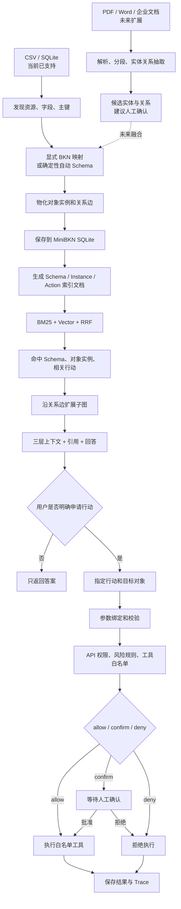

> Archive / 历史文档：保留当时的设计与评测记录；功能现状、启动命令和边界以根目录 [README](../../../README.zh.md) 为准。本机路径已去标识，历史命令不保证适用于当前版本。

# MiniBKN 初次流程理解分析与答疑

> 本文基于项目当前代码，对第一次理解 MiniBKN 时提出的流程和问题逐项整理。目标是区分：
> **哪些理解是正确的、哪些地方需要修正、当前程序实际怎样工作、未来可以怎样扩展。**
>
> 当前项目版本：MiniBKN 0.4.0\
> 记录日期：2026-08-11

---

## 一、先给结论：整体理解对不对

整体方向是正确的，大约已经抓住了八成主流程：

```text
企业数据
  → 理解数据结构和业务关系
  → 建立业务知识网络
  → 建立检索索引
  → 用户提问
  → 返回业务规则、具体事实、关系和相关行动
  → 用户明确申请行动
  → 权限与风险检查
  → 直接执行 / 等待审批 / 拒绝
  → 保存结果和审计记录
```

但是有四个关键点需要修正：

1. **当前不是由 AI 自由猜测所有表格关系。**关系优先由 BKN 文件明确配置；自动生成模式只会
   根据主键和同名的 `*_id` 字段做确定性推断。可选 AI 目前只补充说明文字，不负责改关系。
2. **系统不会在每次提问时直接扫描原始表格或源数据库。**它先把数据转换为对象和关系，再
   生成检索索引快照；提问时搜索这个快照。
3. **当前并不是把所有元素、关系和行动生成到一个单独的“图文件”中。**业务规则可以来自
   `.bkn` 文件，但对象实例、关系边和索引主要保存在本地 SQLite 数据库里。
4. **问答不会自动执行行动。**问答只返回相关行动；用户或 AI 助手必须再次明确调用行动接口，
   才会进入参数校验、风险判断和人工确认流程。

---

## 二、把你的理解整理成更准确的版本

### 第 1 步：用户提供业务数据

当前支持：

- CSV 文件或 CSV 目录；
- SQLite 数据库。

例如：

- 物料库存表；
- 供应商表；
- 采购报价表；
- 合同或审批记录表。

系统会发现有哪些表或文件、有哪些字段、字段类型、主键候选和数据行数。

### 第 2 步：建立“业务说明书”

系统需要知道：

- 哪些表代表哪类业务对象；
- 哪些字段是主键；
- 两类对象通过什么字段关联；
- 某类对象允许执行什么行动；
- 行动需要哪些参数；
- 什么情况下允许、需要审批或禁止执行。

这份说明书就是 BKN Schema。它可以由开发者明确编写，也可以先根据表结构自动生成一个初稿。

### 第 3 步：把表格数据转换成对象和关系

例如：

```text
materials.csv 的一行
  → 物料对象 MAT-001

suppliers.csv 的一行
  → 供应商对象 SUP-001

MAT-001.supplier_id = SUP-001.supplier_id
  → MAT-001 --由……供应--> SUP-001
```

这一步叫“物化”。它把原始表格转换为系统内部可以查询的对象实例和关系边。

### 第 4 步：建立检索索引

系统把以下三类内容变成可以搜索的文档：

1. Schema：对象类型、字段和关系类型；
2. Instance：具体物料、供应商等对象实例；
3. Action：当前启用的业务行动。

每份检索文档同时有关键词信息和向量信息。

### 第 5 步：用户提问并进行混合检索

系统同时执行：

- BM25 关键词检索；
- Vector 向量检索；
- RRF 排名融合。

检索先找到相关 Schema、对象实例和行动。找到对象实例后，系统再沿已经保存的关系边扩展出
相关子图，而不是只返回一个孤立对象。

### 第 6 步：组装三层上下文并回答

回答上下文被分为：

```text
Schema 层：业务规则是什么
实例/子图层：具体事实和关系是什么
Action 层：本次可能采取哪些行动
```

回答还会携带来源，例如某个 BKN 文件或某张 CSV 的具体行号。

### 第 7 步：按需申请行动

如果用户只问问题，系统只返回答案和证据。

如果用户还想采取行动，必须明确调用行动接口，并指定目标对象和行动类型。之后系统才会：

```text
绑定参数
  → 校验参数
  → 计算风险
  → 允许 / 等待确认 / 拒绝
  → 调用白名单工具
  → 保存结果和 Trace
```

---

## 三、逐项答疑

### 问题 1：后续能否从表格扩展到业务文档、企业文档

### 答案

可以，而且这是很合理的下一步，但当前版本还没有实现文档数据源。

表格和企业文档的处理方式不同：

- 表格天然有字段、行和主键，适合直接映射成业务对象；
- Word、PDF、制度文件、合同等主要是非结构化文字，需要先解析、分段，再识别实体和关系。

### 可以分三档扩展

#### 第一档：先把文档当作可检索资料

增加 PDF、Word、Markdown、TXT 适配器：

```text
文档
  → 提取正文
  → 按章节或段落切分
  → 建立关键词和向量索引
  → 返回原文件、页码、章节引用
```

这一档最稳妥，但文档内容仍主要是文本片段，不会自动成为严格的业务对象。

#### 第二档：从文档中抽取候选实体和关系

使用 LLM 从合同或制度中识别：

- 企业名称；
- 合同、产品、金额、日期；
- “供应”“签署”“审批”“归属”等关系；
- 业务规则和限制条件。

因为 LLM 可能抽错，建议先生成“候选图谱”，由用户确认后再进入正式知识网络。

#### 第三档：结构化数据与文档知识融合

表格负责提供确定的业务事实，文档负责提供合同条款、制度说明和背景知识。例如：

```text
数据库：供应商 SUP-001 当前评级为 A
合同 PDF：SUP-001 的交付周期为 15 天
采购制度：金额超过 50 万需要总经理审批
```

查询时同时返回三类证据，行动时仍由 BKN 的确定性规则负责安全控制。

### 建议

未来优先实现第一档，再做第二档。不要一开始就让 AI 自动把所有文档写入正式业务图谱，否则
错误关系会难以发现和清理。

---

### 问题 2：能否使用 LightRAG，MiniBKN 和 LightRAG 有什么区别

### LightRAG 更擅长什么

LightRAG 主要面向非结构化文档。它会把文档切分，使用 LLM 抽取实体和关系，并支持：

- `local`：围绕具体实体检索局部信息；
- `global`：检索跨文档的关系链和宏观主题；
- `hybrid`：合并 local 和 global；
- `naive`：传统文本块向量检索；
- `mix`：融合图检索和文本块检索。

LightRAG 官方说明中也明确指出，它的文档流程依赖 LLM 进行复杂的实体—关系抽取，并使用独立
的 KV、Vector、Graph 和文档状态存储。参考：
[LightRAG 官方 README](https://github.com/HKUDS/LightRAG/blob/main/README.md)、
[LightRAG 论文与流程说明](https://lightrag.github.io/)。

### MiniBKN 更擅长什么

MiniBKN 当前主要面向已经结构化的企业数据和可执行业务流程：

- 对象字段和关系可以明确配置和校验；
- 业务对象能够精确对应到 CSV 行或数据库记录；
- Action、Risk、参数绑定和审批是模型的一部分；
- 可以从问答进入受控业务行动；
- 更强调确定性、可追踪和行动安全。

### 两者不是简单的谁替代谁

| 对比项 | MiniBKN 当前实现 | LightRAG |
| --- | --- | --- |
| 主要数据 | CSV、SQLite 结构化数据 | 文档、文本和多模态内容 |
| 图谱来源 | 明确 Schema/字段映射，少量规则推断 | LLM 从文本抽取实体和关系 |
| 检索重点 | Schema、实例、行动 + 关系扩展 | local/global 图检索 + 文本块检索 |
| 业务行动 | 有 Action、Risk、审批和工具执行 | 主要负责知识检索与回答 |
| 确定性 | 较高，关系可校验 | 更灵活，但依赖抽取模型质量 |
| 当前复杂度 | 小型本地实现，逻辑较简单 | 完整文档图 RAG，组件更多 |

你感觉 MiniBKN 的检索比 LightRAG 简单，这个判断是正确的。当前 MiniBKN 没有实现 LightRAG
的全局主题检索、跨文档关系链检索、文本块回溯和多模式查询路由。

### 推荐的融合方式

未来不建议直接用 LightRAG 替换 MiniBKN，而是把它作为“企业文档知识子系统”：

```text
结构化数据 → MiniBKN → 精确对象、关系、行动和风险

企业文档 → LightRAG → 文档实体、关系、原文片段和宏观知识

用户问题 → 查询路由/融合层 → 合并两边证据 → 回答

明确行动 → 仍交给 MiniBKN 风险门禁执行
```

这样可以同时获得文档理解能力和业务行动安全性。

---

### 问题 3：AI 如何知道两个不同表格之间的关系

### 当前有两种方式

#### 方式一：人工明确配置，最可靠

在 RelationType 中声明：

```text
源对象：material
目标对象：supplier
源字段：supplier_id
目标字段：supplier_id
```

物化时，系统比较两个对象的字段值；值相同就建立关系。

#### 方式二：自动 Schema 的字段规则

当前自动生成逻辑会寻找：

1. 某个对象中以 `_id` 结尾的字段；
2. 另一个对象是否把同名字段作为主键；
3. 如果满足，就生成一条候选 RelationType。

例如：

```text
quotation.supplier_id
supplier.supplier_id（主键）
```

系统可以自动生成：

```text
quotation → supplier
```

### 当前 AI 实际做了什么

可选的 OpenAI-compatible AI 目前只补充对象和关系的描述文字，不能修改 ID、主键、字段映射，
也不会自行新增关系。

因此，“AI 自动理解表关系”在当前项目中不应作为事实表述。更准确的说法是：

> 系统根据字段、主键和显式映射自动建立关系；AI 目前只进行受约束的 Schema 描述增强。

### 当前推断不了哪些情况

如果两个表使用不同名称，例如：

```text
quotation.vendor_code
supplier.supplier_id
```

当前自动规则不会知道它们是同一个概念，需要：

- 用户明确配置映射；或
- 未来增加字段名语义匹配、数据库外键读取、样本值重合分析；或
- 让 LLM 提出候选关系，再由人工确认。

### 对采购报价表和供货表的建议

建议把关系拆清楚：

```text
供应商 supplier
物料 material
采购报价 quotation
供货记录 supply_record

quotation.supplier_id → supplier.supplier_id
quotation.material_id → material.material_id
supply_record.supplier_id → supplier.supplier_id
supply_record.material_id → material.material_id
```

这样不仅知道两个表有关，还能明确“因为什么字段、以什么业务含义相关”。

---

### 问题 4：系统会生成一个包含属性、关系和操作的图结构文件吗

### 答案

概念上会形成一张业务知识网络，但当前实现不是全部输出成一个独立图文件。

当前存储分为三部分：

1. **Schema 定义**：手工模式来自 `.bkn` 文件；自动模式生成后保存为 KnowledgeNetwork 快照。
2. **对象与关系实例**：物化后保存进 SQLite 的对象表和关系表。
3. **检索文档与向量**：建索引后保存进 SQLite 的检索文档表。

Action 和 Risk 属于 Schema 定义，不是普通对象关系边。它们和图谱关联，但有自己的领域模型和
执行逻辑。

更准确的理解是：

```text
业务知识网络
├── Schema：对象、字段、关系、行动、风险
├── Graph：具体对象实例和关系边
└── Search Index：可搜索的 Schema、实例和行动文档
```

未来可以增加 GraphML、JSON 或可视化格式导出，但当前主流程不依赖独立图文件。

---

### 问题 5：检索时是在检索元素，还是检索元素之间的关系

### 当前实际检索的内容

索引中包含：

- ObjectType Schema 文档；
- RelationType Schema 文档；
- ObjectInstance 实例文档；
- 已启用的 ActionType 行动文档。

因此，系统既能搜到“物料是什么”“supplied_by 是什么关系”，也能搜到“MAT-001 是哪个具体
物料”和“创建补货预警是什么行动”。

### 当前没有直接检索什么

具体的关系实例边，例如：

```text
MAT-001 --supplied_by--> SUP-001
```

目前不会作为一份独立 SearchDocument 直接参与 BM25/Vector 排名。系统先检索对象实例，再
从关系表中扩展与这些对象相连的边和邻居。

所以当前方式可以概括为：

```text
先检索相关对象或关系定义
  → 再沿已保存的具体关系边扩展上下文
```

这比 LightRAG 的 local/global 关系检索简单，也更适合当前小型结构化示例。

---

### 问题 6：检索到某个元素后，会返回多少相关内容

需要区分 `/search`、`/ask` 和 `/subgraph` 三种接口。

### `/search`

- 默认返回前 10 条；
- 用户可设置 `limit`；
- 最少 1 条，最多 50 条；
- 可以选择 `bm25`、`vector` 或 `hybrid`。

### `/ask`

当前实现先统一检索前 20 条，再按层筛选：

- Schema 最多 5 条；
- Instance 最多 8 条；
- Action 最多 5 条。

随后围绕命中的实例扩展关联对象和关系，组成 `subgraph`。

这里的自动上下文扩展不是一个复杂的全局图遍历器，当前主要用于补齐命中对象周围的直接相关
关系。供应链示例中会把物料对应的供应商补进来。

### `/subgraph`

如果用户希望明确查询关系范围，可以指定：

- 起始对象；
- 起始实例；
- 深度 1～5。

系统会按深度遍历关系。深度越大，返回内容越多，也越容易引入无关信息。

### 一个需要注意的边界

当前 `/ask` 的上下文数量使用固定上限，没有按 Token 预算、关系类型白名单或动态问题复杂度
进行控制。未来可以增加：

- 最大 Token 预算；
- 关系类型过滤；
- 每类对象的数量上限；
- 图距离衰减；
- reranker 二次排序。

---

### 问题 7：检索部分怎样和数据库连接，它怎么知道去数据库查什么

### 这里最容易产生误解

当前系统不是：

```text
用户提问 → AI 临时生成 SQL → 直接查询原始业务数据库
```

当前系统实际是：

```text
数据源注册和发现
  → 根据 Schema 读取数据行
  → 生成对象和关系，保存到 MiniBKN SQLite
  → 根据对象和 Schema 建立搜索索引，保存到 MiniBKN SQLite
  → 用户提问时读取搜索索引
  → 在 Python 中计算 BM25、向量和 RRF
  → 再读取已物化的对象和关系补充子图
```

### 它为什么知道该读取源数据库的哪些内容

因为 ObjectType 中保存了 DataSourceBinding 和字段映射：

```text
物料对象绑定 materials_csv
sku 属性映射到 sku 列
current_stock 属性映射到 current_stock 列
```

RelationType 又声明了连接字段。系统不是让 AI 临时猜 SQL，而是按照这些提前校验过的映射读取
数据。

### 当前是“快照模式”，不是“实时查询模式”

用户查询的是最近一次 `materialize + index` 生成的快照。源表更新后，需要重新执行：

```text
discover（结构变化时）
  → materialize
  → index
```

否则搜索结果不会自动反映源数据库的最新内容。

### 未来可以怎样扩展

- 定时重新物化和建索引；
- 根据更新时间做增量同步；
- 使用 CDC 监听数据库变化；
- 对金额、库存等强实时字段走实时 SQL 工具；
- 检索负责找到对象和查询意图，再由受控 Query Adapter 执行参数化查询。

如果增加实时查询，必须限制可访问表、字段和查询类型，不能让大模型直接执行任意 SQL。

---

### 问题 8：业务规则、数据库事实和行动是怎样组合起来的

问答阶段返回一个 ContextBundle：

```text
Schema hits
  + Instance hits
  + Subgraph
  + Action hits
```

### Schema hits

来自开始定义的对象类型、字段和关系类型，用于回答“业务结构和规则是什么”。

### Instance hits

来自物化后的具体对象，用于回答“这一次具体涉及谁、数值是多少”。

### Subgraph

来自对象实例关系表，用于补全“这些对象之间如何连接”。

### Action hits

来自已启用的 ActionType，用于提示“针对这类对象可能采取什么行动”。

这就是三层上下文的准确含义：规则、事实/关系、行动建议。

---

### 问题 9：行动是怎么提供给系统的，是全部返回还是只返回相关行动

### 行动从哪里来

当前行动不是从表格自动推断出来的，也不是 AI 临时编造的。它需要在 BKN ActionType 中定义：

- 行动 ID、名称和说明；
- 绑定的对象类型；
- 是否启用；
- 触发条件；
- 对应的工具；
- 工具需要的参数；
- 参数从对象的哪个属性取得。

例如补货预警行动绑定 `material`，参数 `sku`、`current_stock` 和 `safety_stock` 从物料属性获取。

### 索引阶段怎样处理行动

每个已启用的行动会变成一份 SearchDocument，内容包括：

- 行动名称；
- 行动描述；
- 绑定对象类型。

它和 Schema、实例一起参加 BM25 和 Vector 检索。

### 问答时返回多少行动

不是返回全部行动。当前 `/ask` 最多返回检索排名靠前的 5 个行动。

### 当前怎样判断“相关”

当前主要根据用户问题与行动名称、说明、绑定对象类型之间的关键词和向量相似度判断。

这是一种较简单的相关性判断。执行阶段还会再次检查：

- 行动是否启用；
- 行动是否绑定当前对象类型；
- 目标对象是否存在；
- 参数是否完整；
- 风险规则是否适用。

### 可以怎样加强

未来可以在召回行动时增加硬过滤：

- 只返回绑定到已检索对象类型的行动；
- 检查 Trigger Condition 是否满足；
- 检查当前用户角色是否有申请权限；
- 按风险等级和业务状态过滤；
- 先硬过滤，再做语义排序。

这会比单纯依赖文本相关度更适合生产系统。

---

### 问题 10：用户提出行动要求后会发生什么

### 当前问答与执行是分开的

用户问：

> 哪些物料库存不足？

系统只回答问题，不会执行任何工具。

用户接着明确提出：

> 为 MAT-001 创建补货预警。

如果通过 API 或 MCP 调用 `request_action`，才会进入行动流程。

### 行动流程

```text
指定 ActionType 和目标实例
  → 检查行动与对象类型是否匹配
  → 从对象属性绑定参数
  → 拒绝缺失或未知参数
  → 计算 RiskType
  → deny 优先，其次 confirm，否则 allow
  → 只查找白名单工具
  → 执行并保存标准结果
  → 写入 TraceEvent
```

### 当前有哪些“权限和审批”

需要区分三个概念：

1. **API Key**：粗粒度地阻止未授权调用 API；
2. **风险审批**：高风险行动返回 `pending_confirmation`，等待确认接口；
3. **工具白名单**：未注册工具不能执行。

当前还没有企业级 RBAC、部门权限、审批人身份校验或多级审批流。因此不能把当前实现描述成
完整企业权限系统。它实现的是一个可证明的安全行动 MVP。

---

## 四、用采购报价场景重新走一遍

假设有四张表：

```text
supplier：供应商
material：物料
quotation：采购报价
approval_record：审批记录
```

### 建模

```text
quotation.supplier_id → supplier.supplier_id
quotation.material_id → material.material_id
approval_record.quotation_id → quotation.quotation_id
```

### 可定义的行动

- 提交报价审批；
- 批准报价；
- 拒绝报价；
- 创建采购申请；
- 通知供应商重新报价。

### 风险规则示例

- 报价金额小于 1 万：允许直接提交部门审批；
- 1 万～50 万：需要采购经理确认；
- 超过 50 万：禁止自动执行，必须进入外部正式审批系统。

### 用户提问

> 物料 M-100 有哪些供应商报价，价格最低的是谁，是否可以直接采购？

### 系统应组装的上下文

```text
Schema：报价、供应商、物料之间的关系和审批规则
实例：M-100 的报价记录、供应商资料和相关审批记录
子图：M-100 → 报价 → 供应商
行动：提交采购申请、发起审批
```

### 用户明确行动

> 对最低报价发起采购申请。

系统再根据金额、用户权限和风险规则决定直接执行、等待确认或拒绝。

当前 MiniBKN 已具备这套流程所需的核心结构，但示例只实现了库存补货预警；采购报价需要新增
对应数据、BKN Schema、ActionType、RiskType 和白名单工具。

---

## 五、当前流程与理想流程的差距

| 能力 | 当前 MiniBKN | 更完整的目标 |
| --- | --- | --- |
| 数据源 | CSV、SQLite | MySQL、PostgreSQL、API、文档系统 |
| 文档接入 | 未实现 | PDF、Word、Markdown、图片、表格解析 |
| 关系发现 | 显式映射 + 同名 `_id` 规则 | 外键、值重合、语义推断、人工确认 |
| 图存储 | SQLite 对象表和关系表 | 可选 Neo4j、PostgreSQL Graph 等 |
| 检索 | BM25 + 向量 + RRF | reranker、Token 预算、图距离、local/global |
| 问答 | 库存场景抽取式回答 | 通用、受证据约束的生成式回答 |
| 数据时效 | 手工重新物化和建索引 | 定时、增量或 CDC 同步 |
| 行动召回 | 文本相关度，最多 5 个 | 对象类型、触发条件、权限硬过滤后排序 |
| 权限 | API Key | OAuth、RBAC、部门和数据权限 |
| 审批 | 单次确认 | 多角色、多级、可配置审批流 |
| 行动工具 | 本地演示工具 | 企业采购、付款、审批等受控连接器 |

---

## 六、建议的后续扩展顺序

### 阶段 E：企业文档只读检索

- 支持 TXT、Markdown、PDF、DOCX；
- 文档解析和分段；
- 保存文件、页码、章节引用；
- 文档片段参与 BM25 和 Vector 检索；
- 暂不自动写入正式实体关系。

### 阶段 F：候选实体和关系抽取

- 使用 LLM 或 LightRAG 抽取实体和关系；
- 标记来源片段和置信度；
- 进入候选区，不直接修改正式图谱；
- 用户审核后发布到正式 BKN。

### 阶段 G：结构化数据与 LightRAG 融合查询

- MiniBKN 查询精确业务对象、数值、行动和风险；
- LightRAG 查询合同、制度、手册和跨文档关系；
- 查询路由器判断使用哪一路或同时使用；
- 对证据去重、排序并统一引用；
- 所有业务行动仍从 MiniBKN 的安全执行链路进入。

### 阶段 H：实时数据和企业级治理

- 增量索引或 CDC；
- 参数化实时查询；
- RBAC 和数据权限；
- 多级审批；
- 外部工具连接器；
- 更完整的 Trace 与监控。

---

## 七、最终准确流程图



---

## 八、这次理解中最值得保留的几点

你的理解中有几个非常准确、也很适合面试时展开的点：

1. 这个项目不是单纯搜索表格，而是先把业务数据组织成对象和关系；
2. 检索不只返回数据，还要带上业务规则和可能采取的行动；
3. 检索与行动是两段不同流程，行动需要权限、审批和风险控制；
4. MiniBKN 的检索比 LightRAG 简单，因为两者当前面向的主要数据和目标不同；
5. “关系怎么建立”“检索如何连接数据库”“行动为什么相关”正是这个项目最重要的架构问题。

经过本次修正，可以把项目概括为：

> MiniBKN 先用可校验的 Schema 把结构化企业数据变成对象和关系，再对业务规则、具体实例和
> 可执行行动进行混合检索；问答只负责提供带来源的上下文，明确的行动请求才会进入参数校验、
> 风险审批、白名单工具执行和 Trace 审计链路。未来可通过文档适配器或 LightRAG 补充企业文档
> 知识，但安全行动仍应由确定性的 BKN 规则控制。
