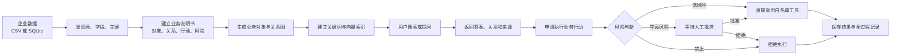
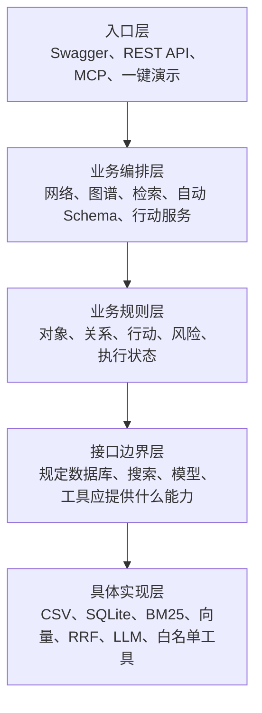

> Archive / 历史文档：保留当时的设计与评测记录；功能现状、启动命令和边界以根目录 [README](../../../README.zh.md) 为准。本机路径已去标识，历史命令不保证适用于当前版本。

# MiniBKN 完整项目汇报：写给非技术负责人的版本

> 文档目的：不要求读者具备后端、人工智能或知识图谱基础，也能理解这套系统为什么要做、
> 做成了什么、内部如何运转、目前能做什么，以及怎样亲自使用和验收。
>
> 项目版本：MiniBKN 0.4.0\
> 开发状态：约定的 Python 核心流程已经完成并通过本地验收\
> 项目位置：`<local-path>`

---

## 一、先用一句话说明：我们到底做了什么

我们搭建了一套轻量级的“企业业务知识大脑”。

它可以读取企业已有的 CSV 表格或 SQLite 数据库，理解里面有哪些业务对象、这些对象之间有
什么关系，然后回答业务问题；当问题需要采取行动时，它还能先判断风险，必要时等待人工批准，
再调用提前登记好的安全工具，并把整个过程记录下来。

如果把普通企业数据系统比作一间堆满表格的档案室，那么 MiniBKN 同时扮演了四个角色：

1. **业务资料管理员**：知道每张表是什么、每个字段是什么意思。
2. **关系分析员**：知道某个物料属于谁、由谁供应、与哪些对象有关。
3. **安全执行员**：不仅给出答案，还能按规则申请执行补货预警等动作。
4. **审计员**：记录系统为什么做出这个判断、是否经过审批、工具有没有真正执行。

因此，它不是一个只能聊天的机器人，而是一套从“业务数据”一直走到“业务行动”的完整闭环。

---

## 二、为什么不直接复现原项目的全部内容

原始 BKN Foundry 是一套面向大型企业部署的平台，包含很多微服务、Kubernetes、消息系统、
搜索服务、权限系统和基础设施。完整复现它需要多台服务协同，部署和维护成本很高，也不利于
秋招时在一台电脑上快速演示。

本项目采取了一个更务实的方案：

- 保留原项目最有价值的业务思想和主流程；
- 以 Python 为主要开发语言；
- 把许多独立服务收拢到一个 FastAPI 程序中；
- 默认只依赖本地文件和 SQLite；
- 不依赖 Kubernetes、Redis、Kafka、OpenSearch 或外部大模型也能运行；
- 各模块仍保持清晰边界，以后需要时可以替换或拆分。

这种架构叫作**模块化单体**。通俗地说，就是“目前住在一栋楼里，但每个部门都有独立办公室
和明确职责”。它比一开始就建设十几栋楼更容易启动和维护，同时又避免所有代码混成一团。

这项取舍很适合本项目的真实目标：在有限时间内，做出一个能运行、能解释、能测试、能现场
演示的完整作品，而不是搭出一个很庞大但跑不起来的半成品平台。

---

## 三、系统解决了传统 RAG 的哪些问题

普通 RAG 可以简单理解为：“先从一堆文字里找相似片段，再让 AI 根据片段回答”。它在企业
结构化数据场景中常见几个问题：

1. **资料被切碎后，关系容易丢失**：系统可能知道一个物料，也知道一个供应商，却不知道它们
   为什么有关联。
2. **精确编号容易搜不准**：物料号、订单号、字段名等精确信息，不一定适合只用语义相似度找。
3. **答案来源不透明**：回答错误时，很难知道它引用了哪张表的哪一行。
4. **只能回答，不能办事**：即便发现库存不足，也不能安全地触发下一步业务操作。
5. **执行风险不可控**：如果 AI 可以随意调用工具，可能造成错误下单或越权操作。

MiniBKN 对应提供了以下解决办法：

| 传统问题 | MiniBKN 的处理方式 |
| --- | --- |
| 实体关系丢失 | 把表格行转成业务对象，并持久化对象之间的关系 |
| 精确编号搜索弱 | 同时使用关键词检索和向量检索 |
| 单一路线容易漏结果 | 用 RRF 融合两路检索排名 |
| 回答来源不清 | 返回 BKN 定义文件和 CSV 精确行号 |
| 上下文杂乱 | 按“业务规则、具体实例、可执行行动”分三层组织 |
| 只能回答不能执行 | 增加行动注册、参数绑定和工具执行 |
| AI 行动有风险 | 增加允许、需确认、禁止三类风险策略 |
| 过程无法追责 | 用 `trace_id` 保存完整事件链 |

---

## 四、整体业务流程是什么样的

下面这张图不需要从技术角度看。可以把它理解成一条企业业务流水线：



### 用供应链例子解释这条流程

系统内置的主演示场景是库存与供应商管理：

1. `materials.csv` 中有物料名称、库存、安全库存、单价和供应商编号。
2. `suppliers.csv` 中有供应商名称和联系方式。
3. 系统发现两张表，并识别出物料和供应商两类业务对象。
4. 系统根据 `supplier_id` 建立“物料由供应商供应”的关系。
5. 用户问：“哪些物料库存低于安全库存，它们由谁供应？”
6. 系统找到库存不足的 MAT-001 和 MAT-003，并沿关系找到 Precision Components。
7. 系统返回答案，同时标明事实来自哪份 BKN 定义、哪张 CSV 的哪一行。
8. 用户可以申请创建补货预警。
9. 系统计算预计补货价值：
   - MAT-001 的金额为 935，超过 500，必须人工确认；
   - MAT-003 的金额为 394.8，可以直接执行。
10. 经批准后，系统调用已经登记的本地补货预警工具，并记录完整过程。

这里的工具只会生成本地演示结果，不会真实下单、扣款或联系供应商。

---

## 五、系统架构是什么样的

### 5.1 从使用者角度看

使用者不需要理解内部代码，只需要接触最上面一层：

- 浏览器中的 Swagger 操作页面；
- REST API；
- 一键演示脚本；
- MCP 工具接口，供支持 MCP 的 AI 助手调用。

### 5.2 从管理者角度看

系统内部被划分为五层，每一层只负责一类事情：



| 层级 | 通俗职责 | 主要内容 |
| --- | --- | --- |
| 入口层 | 接待用户和其他系统 | FastAPI、Swagger、MCP、演示脚本 |
| 业务编排层 | 决定一件事按什么顺序完成 | 数据物化、建索引、问答、行动执行 |
| 业务规则层 | 定义哪些东西是合法的 | 对象、关系、风险策略、执行状态 |
| 接口边界层 | 规定外部零件的标准插口 | Repository、DataSource、Embedder、Tool 等接口 |
| 具体实现层 | 真正读文件、存数据、计算排名 | SQLite、CSV、BM25、向量、RRF、LLM 适配器 |

这种分层的价值是：以后要把 SQLite 换成 MySQL、把本地向量换成真实模型、把演示工具换成
企业接口时，主要替换最下面的实现，不需要推翻上面的业务流程。

### 5.3 五个核心业务模块

| 模块 | 可以理解成 | 负责什么 |
| --- | --- | --- |
| Network Service | 业务规则管理员 | 导入、解析、校验和保存 BKN 定义 |
| Graph Service | 关系建模员 | 发现数据、生成对象、建立关系、查询子图 |
| Retrieval Service | 企业资料检索员 | 建索引、混合检索、拼装上下文、生成回答 |
| Schema Generation Service | 数据建模助理 | 根据表和字段自动生成初始业务模型 |
| Action Service | 安全执行经理 | 参数绑定、风险判断、审批、工具调用和审计 |

### 5.4 为什么要设置“接口边界”

可以把接口边界理解成统一规格的插座。例如，业务层只知道“我需要保存知识网络”，但不关心
背后使用 SQLite 还是 MySQL。只要新的数据库实现符合这个插座标准，业务层就不用修改。

这体现了项目的工程价值：它不仅能完成演示，也为后续扩展保留了合理位置。

---

## 六、几个关键概念，用人话怎么理解

| 术语 | 人话解释 | 示例 |
| --- | --- | --- |
| BKN | 一套对企业业务知识的结构化说明 | 物料、供应商、它们的关系和可执行行动 |
| Schema | 业务数据的说明书或设计图 | 物料有哪些字段，哪个字段是唯一编号 |
| ObjectType | 一类业务对象 | 物料、供应商 |
| ObjectInstance | 某一个具体业务对象 | MAT-001 温度传感器 |
| RelationType | 两类对象之间的关系规则 | 物料由供应商供应 |
| Subgraph | 围绕某个对象找到的一小片关系网 | MAT-001 以及它的供应商 SUP-001 |
| ActionType | 系统允许申请执行的业务动作 | 创建补货预警 |
| RiskType | 行动执行前的安全规则 | 金额超过 500 必须确认 |
| BM25 | 擅长精确关键词和编号的搜索方法 | 搜索 MAT-001、supplier_id |
| Vector | 根据含义相似程度找内容的方法 | “库存不足”和“缺货”含义接近 |
| RRF | 把多种搜索排名公平合并的方法 | 综合关键词排名和向量排名 |
| 三层上下文 | 分层交给问答系统的证据 | 规则层、实例关系层、行动层 |
| Citation | 答案的来源凭证 | `resource://materials_csv#row=2` |
| Trace | 一次操作的完整流水账 | 请求、风险计算、批准、工具成功 |
| MCP | AI 助手调用外部工具的通用接口 | AI 助手调用 MiniBKN 搜索或申请行动 |

---

## 七、凌晨完成了哪些具体工作

### 7.1 阶段 A：搭地基和建立业务规则

这一阶段完成了：

- 创建 Python 3.11 + FastAPI 项目；
- 建立 SQLite 数据持久化；
- 定义知识网络、对象、关系、行动和风险模型；
- 编写简化版 BKN 文档解析器；
- 增加跨文件校验，防止错误关系和错误字段进入系统；
- 建立统一错误格式和 `trace_id`；
- 提供知识网络导入、列表和 Schema 查询接口；
- 准备供应链主演示数据。

阶段 A 的意义是让系统先“看懂业务设计图”，并确保设计图本身合法。

### 7.2 阶段 B：把真实数据变成可查询的业务知识

这一阶段完成了：

- 接入 CSV 和 SQLite 两类数据源；
- 自动发现表、字段、类型、主键候选和数据量；
- 把表格行转换为物料、供应商等业务对象；
- 根据外键字段建立对象关系；
- 支持围绕一个对象查询一跳到多跳关系；
- 实现 BM25、离线向量和 RRF 混合检索；
- 建立 Schema、实例/子图、行动三层上下文；
- 实现不依赖大模型的抽取式问答；
- 为答案返回文件和数据行引用。

阶段 B 的意义是让系统从“会看图纸”升级为“会读真实业务数据并回答问题”。

### 7.3 阶段 C：从回答问题走到安全执行

这一阶段完成了：

- 从业务对象自动填写行动参数；
- 校验必填参数和禁止未知参数；
- 根据业务规则计算风险；
- 支持直接允许、等待确认、直接拒绝三种处置；
- 建立只允许已注册工具的白名单；
- 建立行动状态机，包括等待确认、运行、成功、失败和拒绝；
- 防止已经结束的行动被重复确认；
- 保存请求、风险、审批和工具执行的完整 Trace。

阶段 C 的意义是让系统不只“提供建议”，还能在安全边界内“采取行动”。

### 7.4 阶段 D：把项目变成可交付、可展示、可评测的作品

这一阶段完成了：

- 编写一键端到端演示脚本；
- 提供 Dockerfile 和 Docker Compose；
- 编写 README、架构、验收和阶段报告；
- 增加 API Key 保护；
- 增加真实 Sentence Transformers 语义模型适配器；
- 根据数据表自动生成初始 Schema；
- 增加可选的 OpenAI-compatible AI Schema 说明增强；
- 建立原生 MCP 2.x Server；
- 建立 200 条固定检索评测集；
- 实际运行离线评测和 Ragas ID 指标；
- 修复 Ragas 与新版 LangChain 之间的依赖兼容问题；
- 完成全部测试、代码格式和严格类型检查。

阶段 D 的意义是让项目从“开发者电脑上的代码”变成“其他人可以理解、启动和验收的作品”。

---

## 八、用户现在可以使用哪些功能

### 8.1 数据管理能力

- 注册一个 CSV 文件、CSV 目录或 SQLite 数据库；
- 查看系统发现了哪些资源；
- 查看每个资源的字段、类型、主键候选和行数；
- 使用已有 BKN 业务定义；
- 或根据实际数据自动生成初始知识网络。

### 8.2 知识图谱能力

- 把数据行转换为业务对象；
- 根据映射建立业务关系；
- 查询某类对象的全部实例；
- 从某个对象出发查询最多五层关系子图；
- 查看完整业务 Schema。

### 8.3 搜索和问答能力

- 单独使用关键词搜索；
- 单独使用向量搜索；
- 使用 BM25 + Vector + RRF 混合搜索；
- 对业务网络进行自然语言提问；
- 查看回答所使用的三层上下文；
- 查看每条答案引用的 BKN 文件或 CSV 行。

### 8.4 业务行动能力

- 针对一个业务对象申请执行行动；
- 自动从对象数据中填写所需参数；
- 查看风险判断及原因；
- 批准或拒绝待确认行动；
- 查询行动当前状态和标准化结果；
- 用 `trace_id` 回看完整过程。

### 8.5 系统接入能力

- 通过 REST API 接入其他程序；
- 通过 Swagger 页面手工操作；
- 通过 MCP 让支持该协议的 AI 助手调用；
- 可设置 API Key，阻止未授权请求；
- 可切换为真实 Sentence Transformers 语义模型；
- 可配置兼容 OpenAI 的模型增强自动 Schema 描述。

---

## 九、最简单的使用方法：一分钟看完整效果

这是最推荐给第一次体验者的方法。它不需要理解 API，也不会调用真实外部服务。

### 第一步：打开 PowerShell

进入项目的 Python 子目录：

```powershell
cd "<local-path>"
```

### 第二步：运行一键演示

```powershell
.\scripts\demo.ps1
```

### 第三步：看输出中的关键结果

正常情况下会看到：

- `materials_csv` 和 `suppliers_csv` 两个资源；
- 5 个业务对象；
- 3 条供应关系；
- 9 个检索文档；
- MAT-001 和 MAT-003 库存不足；
- 供应商是 Precision Components；
- 行动执行前状态为 `pending_confirmation`；
- 批准后状态为 `succeeded`；
- 最后一个 Trace 事件是 `tool.succeeded`。

演示脚本每次会创建一个独立数据库，不会覆盖之前的数据。

---

## 十、通过浏览器使用：适合手工体验每一步

### 10.1 首次安装环境

项目要求 Python 3.11。当前机器已经准备好环境；如果需要重新安装，在 `minibkn` 目录执行：

```powershell
uv sync --python <local-path> --extra dev --no-editable
Copy-Item .env.example .env
```

这里使用 `--no-editable` 是因为项目路径包含中文，Windows Python 3.11 某些环境会用 GBK
读取 editable 安装生成的路径文件，从而在启动时出现编码错误。

### 10.2 启动服务

```powershell
.venv\Scripts\python.exe -m uvicorn minibkn.main:app --host 127.0.0.1 --port 8000
```

当窗口显示服务已启动后，不要关闭该窗口。

### 10.3 打开操作页面

在浏览器打开：

```text
http://127.0.0.1:8000/docs
```

Swagger 页面会列出全部功能。操作某个接口时：

1. 点击接口名称；
2. 点击 `Try it out`；
3. 填写请求内容；
4. 点击 `Execute`；
5. 在下方查看返回结果。

### 10.4 推荐操作顺序

#### 第 1 步：导入供应链业务定义

调用：

```text
POST /api/v1/networks/import
```

请求内容：

```json
{
  "path": "<local-path>"
}
```

#### 第 2 步：注册示例数据目录

调用：

```text
POST /api/v1/sources
```

请求内容：

```json
{
  "id": "supply_chain_files",
  "name": "供应链示例数据",
  "kind": "csv",
  "path": "<local-path>"
}
```

#### 第 3 步：让系统发现文件和字段

调用：

```text
POST /api/v1/sources/supply_chain_files/discover
```

不需要填写请求体。

#### 第 4 步：生成业务对象和关系

调用：

```text
POST /api/v1/networks/supply_chain/materialize
```

预期得到 5 个对象和 3 条关系。

#### 第 5 步：建立检索索引

调用：

```text
POST /api/v1/networks/supply_chain/index
```

预期得到 9 个索引文档。

#### 第 6 步：提出业务问题

调用：

```text
POST /api/v1/networks/supply_chain/ask
```

请求内容：

```json
{
  "question": "哪些物料库存低于安全库存，它们由谁供应？"
}
```

返回结果中重点看：

- `answer`：最终回答；
- `context`：系统找到的三层证据；
- `citations`：证据来自哪里。

#### 第 7 步：申请创建补货预警

调用：

```text
POST /api/v1/networks/supply_chain/actions/create_replenishment_alert/execute
```

请求内容：

```json
{
  "object_type_id": "material",
  "instance_id": "MAT-001",
  "parameters": {}
}
```

因为 MAT-001 的预计补货价值为 935，返回状态应为：

```text
pending_confirmation
```

请从返回结果中复制行动的 `id`。

#### 第 8 步：批准或拒绝行动

调用：

```text
POST /api/v1/action-executions/{execution_id}/confirm
```

把 `{execution_id}` 替换成上一步返回的 `id`。

批准：

```json
{
  "approved": true
}
```

拒绝：

```json
{
  "approved": false
}
```

#### 第 9 步：查看全过程

从行动结果中复制 `trace_id`，调用：

```text
GET /api/v1/traces/{trace_id}
```

可以看到请求、风险判断、等待确认、人工决定和工具执行等事件。

---

## 十一、不手写 BKN 时，怎样自动建立业务模型

如果用户只有一批 CSV 或 SQLite 数据，不知道怎样编写 BKN 定义，可以走自动 Schema 路径：

1. 注册数据源；
2. 调用 `discover` 发现表和字段；
3. 调用 `POST /api/v1/sources/{source_id}/generate-network`；
4. 系统根据资源名称、主键候选和 `_id` 外键生成对象与关系；
5. 再调用 `materialize` 和 `index` 即可进入检索流程。

生成请求示例：

```json
{
  "network_id": "my_business",
  "name": "我的业务知识网络",
  "use_ai": false
}
```

如果配置了兼容 OpenAI 的模型，可以把 `use_ai` 改成 `true`。AI 只负责补充更易懂的业务说明，
不能修改对象 ID、主键和字段映射。这样既利用 AI，又避免它随意改变可执行结构。

---

## 十二、怎样启用可选增强功能

### 12.1 启用真实语义模型

默认向量通道是轻量离线版本，不需要下载大模型。若希望使用真实 Sentence Transformers：

```powershell
uv sync --extra dev --extra semantic --no-editable --reinstall-package minibkn
$env:MINIBKN_EMBEDDING_PROVIDER="sentence_transformers"
```

首次运行会从网络下载模型，因此需要等待并占用一定磁盘空间。没有启用时，系统仍可完整运行。

### 12.2 启用 AI Schema 描述增强

在 `.env` 中配置：

```text
MINIBKN_LLM_PROVIDER=openai_compatible
MINIBKN_LLM_API_KEY=你的密钥
MINIBKN_LLM_BASE_URL=兼容服务的地址
MINIBKN_LLM_MODEL=模型名称
```

不要把真实密钥提交到 Git。

### 12.3 启用 API Key 保护

在 `.env` 中设置：

```text
MINIBKN_API_KEY=你自己设置的密钥
```

设置后，所有 `/api/*` 请求都必须携带相同的 `x-api-key`。`/health` 健康检查仍然公开。

### 12.4 让 AI 助手通过 MCP 使用系统

先启动 MiniBKN HTTP 服务，再让 MCP 客户端运行：

```text
<local-path>
```

需要提供：

```text
MINIBKN_API_BASE_URL=http://127.0.0.1:8000
MINIBKN_API_KEY=与服务端一致，可留空
```

MCP 提供三个工具：

| 工具 | 作用 |
| --- | --- |
| `search_knowledge` | 搜索业务知识 |
| `ask_knowledge` | 提问并得到带引用回答 |
| `request_action` | 申请执行受控行动 |

即使通过 MCP 调用，行动也不能绕过风险判断和人工确认。

---

## 十三、系统目前提供了哪些接口

这一节用于查阅，不要求记忆。

| 接口 | 用户能做什么 |
| --- | --- |
| `GET /health` | 检查服务是否正常 |
| `POST /api/v1/networks/import` | 导入已有 BKN 业务定义 |
| `GET /api/v1/networks` | 查看知识网络列表 |
| `GET /api/v1/networks/{id}/schema` | 查看完整业务说明书 |
| `POST /api/v1/sources` | 注册 CSV 或 SQLite 数据源 |
| `GET /api/v1/sources` | 查看已注册的数据源 |
| `POST /api/v1/sources/{id}/discover` | 发现资源和字段 |
| `POST /api/v1/sources/{id}/generate-network` | 自动生成知识网络 |
| `POST /api/v1/networks/{id}/materialize` | 把原始数据变成对象和关系 |
| `GET /api/v1/networks/{id}/object-types/{type}/instances` | 查看某类对象实例 |
| `POST /api/v1/networks/{id}/subgraph` | 查询某个对象周围的关系网 |
| `POST /api/v1/networks/{id}/index` | 建立检索索引 |
| `POST /api/v1/networks/{id}/search` | 搜索业务知识 |
| `POST /api/v1/networks/{id}/ask` | 用自然语言提问 |
| `POST /api/v1/networks/{id}/actions/{action}/execute` | 申请执行行动 |
| `POST /api/v1/action-executions/{id}/confirm` | 批准或拒绝行动 |
| `GET /api/v1/action-executions/{id}` | 查看行动状态和结果 |
| `GET /api/v1/traces/{trace_id}` | 查看一次行动的完整过程 |

---

## 十四、混合检索到底是怎样工作的

搜索时，系统会同时派出两名“资料员”：

- **关键词资料员 BM25**：擅长找完全匹配的编号、名称和字段；
- **含义资料员 Vector**：擅长找说法不同但意思相近的内容。

随后由 RRF 排名融合器汇总两人的结果。RRF 不要求两套搜索系统使用相同分数标准，而是根据
各自排名进行合并，因此实现简单、解释清楚，也适合本地项目。

用户还可以明确指定搜索模式：

- `bm25`：只看关键词；
- `vector`：只看向量；
- `hybrid`：合并两路结果，默认模式。

API 返回两路名次和融合分数，因此面试时可以解释结果为何排在前面，而不是只展示一个黑盒
答案。

---

## 十五、什么是“三层上下文”

系统不会把所有搜到的文字杂乱地交给问答模块，而是分成三层：

1. **Schema 层——业务规则**：物料有哪些字段，供应关系如何定义。
2. **实例与子图层——具体事实**：MAT-001 当前库存是多少，它由哪个供应商供应。
3. **行动层——下一步能做什么**：是否存在创建补货预警的行动。

可以把它类比成向管理者汇报时依次说明：

```text
制度怎么规定
    ↓
这次具体发生了什么
    ↓
接下来可以采取什么措施
```

这种组织方式比把所有文本一次性塞进去更清楚，也便于控制上下文长度和排查错误。

---

## 十六、安全机制怎样避免 AI 乱操作

系统设置了四道门：

### 第一关：行动必须提前定义

系统不能临时编造一个不存在的业务行动。

### 第二关：工具必须进入白名单

即使 BKN 中声明了某个工具，如果它没有在程序的 ToolRegistry 中注册，也不能执行。系统没有
开放“运行任意 Python 代码”的接口。

### 第三关：参数必须校验

行动参数优先从可信业务对象中提取。缺少必填值或传入陌生参数时，请求会在到达工具前被拒绝。

### 第四关：风险决定执行方式

- `allow`：允许直接执行；
- `confirm`：暂停并等待人工批准；
- `deny`：直接拒绝，工具不会被触达。

每个结果都会保存状态、参数、风险原因、时间和 Trace，方便审计。

---

## 十七、开发结果是否经过验证

最终回归结果如下：

| 检查项目 | 结果 | 通俗含义 |
| --- | --- | --- |
| Pytest | 13 个测试全部通过 | 主要功能和失败路径能按预期运行 |
| Ruff format | 58 个文件格式正确 | 代码风格统一 |
| Ruff lint | 全部通过 | 没有发现常见代码质量问题 |
| mypy strict | 44 个源文件无问题 | 严格类型检查通过 |
| 一键演示 | 通过 | 完整业务流程实际跑通 |
| MCP 测试 | 通过 | 客户端能发现并调用 MCP 工具 |
| Docker Compose 配置 | 解析通过 | 容器配置语法有效 |
| Docker 镜像构建 | 未实跑 | 当时 Docker Desktop 服务未启动 |

测试不仅覆盖成功流程，还覆盖了：

- 错误的 BKN 关系必须被拒绝；
- 数据源发现和 SQLite 读取；
- 自动 Schema 生成；
- API Key 未授权请求；
- 高风险行动暂停；
- 人工批准与拒绝；
- 重复确认被阻止；
- 被拒绝的行动不能调用工具；
- MCP 客户端与服务端真实协议交互；
- AI Schema 请求不能擅自改变结构。

---

## 十八、200 条评测说明了什么

项目建立了 200 条固定供应链查询，用来比较三种搜索方式。每道题都保存了正确文档 ID 和完整
搜索排名，因此结果可以复算。

| 模式 | 第一名命中率 | 前三名命中率 | 综合排名质量 MRR |
| --- | ---: | ---: | ---: |
| Vector 离线基线 | 51.5% | 76.0% | 0.6442 |
| BM25 | 73.5% | 89.0% | 0.8227 |
| Hybrid RRF | 73.0% | 83.5% | 0.7934 |

怎样理解：

- 混合检索相比当前离线 Vector，第一名命中率提高了 21.5 个百分点；
- MRR 从 0.6442 提高到 0.7934；
- BM25 在这批题上略好于混合检索，因为题目中有很多物料编号和字段名，正是关键词搜索擅长
  的内容；
- 这说明不能为了简历好看就声称“混合检索永远最好”，而应该根据真实数据调节策略。

参考简历中的 Context Precision 0.78、Faithfulness 0.89 和 Token 降低 36% 没有被冒充为本
项目结果。Faithfulness 需要额外的评审大模型和凭证，当前没有执行，所以报告中明确标记为未
测量。

---

## 十九、项目文件应该去哪里看

| 想了解什么 | 文件或目录 |
| --- | --- |
| 本文，非技术完整汇报 | `MINIBKN_NON_TECHNICAL_FULL_REPORT.md` |
| 长期开发事实和决策 | `MINIBKN_REPRODUCTION_PLAN.md` |
| 最终验收结果 | `MINIBKN_FINAL_ACCEPTANCE_REPORT.md` |
| 阶段 A-D 的通俗报告 | `MINIBKN_DEVELOPMENT_REPORT_PHASE_*.md` |
| 项目运行说明 | `minibkn/README.md` |
| 简要技术架构 | `minibkn/docs/ARCHITECTURE.md` |
| 验收命令 | `minibkn/docs/ACCEPTANCE.md` |
| Python 核心代码 | `minibkn/src/minibkn/` |
| 供应链示例 | `minibkn/examples/supply_chain/` |
| 自动化测试 | `minibkn/tests/` |
| 一键演示 | `minibkn/scripts/demo.ps1` |
| 200 条评测数据 | `minibkn/evals/datasets/supply_chain_200.jsonl` |
| 完整评测结果 | `minibkn/evals/results/` |

核心代码目录的含义：

```text
src/minibkn/
├── api/           对外的 HTTP 接口
├── application/   五个业务服务，负责流程编排
├── domain/        对象、关系、风险等核心业务规则
├── ports/         数据库、搜索、工具等标准接口
├── adapters/      CSV、SQLite、检索、LLM、工具的具体实现
├── evaluation/    200 条评测集和评分逻辑
├── observability/ trace_id 与过程记录
├── main.py        FastAPI 程序入口
└── mcp_server.py  MCP 服务入口
```

---

## 二十、常见问题和处理办法

### 20.1 PowerShell 提示找不到 `.venv`

说明依赖还没有安装。进入 `minibkn` 目录执行：

```powershell
uv sync --python <local-path> --extra dev --no-editable
```

### 20.2 Python 启动时报中文路径编码错误

请确认安装命令包含 `--no-editable`。源码变化后可以执行：

```powershell
uv sync --extra dev --no-editable --reinstall-package minibkn
```

### 20.3 浏览器打不开 `/docs`

检查启动服务的 PowerShell 窗口是否仍在运行，再访问：

```text
http://127.0.0.1:8000/health
```

如果返回 `{"status":"ok"}`，说明服务正常。

### 20.4 API 返回 `UNAUTHORIZED`

说明 `.env` 设置了 `MINIBKN_API_KEY`。请求需要携带相同的 `x-api-key`，或者在纯本地体验时
暂时把该配置留空并重启服务。

### 20.5 搜索提示索引没有建立

在提问前先调用：

```text
POST /api/v1/networks/{network_id}/index
```

如果原始数据改变，还应重新执行 `materialize` 和 `index`。

### 20.6 Docker 启动失败

先确认 Docker Desktop 已启动，再执行：

```powershell
docker compose up --build
```

当前已验证 Compose 配置可以解析，但凌晨验收时 Docker Desktop 服务没有运行，因此容器镜像
本身尚未在这台机器上完成构建。

### 20.7 AI 增强无法调用

AI Schema 是可选能力。检查 `.env` 中的 Provider、API Key、Base URL 和 Model 是否同时配置。
不配置 AI 也不会影响主流程。

---

## 二十一、目前有哪些明确边界

MiniBKN 是为秋招和本地演示设计的核心复现，不是完整替代上游商业平台。目前没有实现：

- Kubernetes 多服务集群；
- 上游全部数据库和数据源连接器；
- 企业级 OAuth、多租户和细粒度权限；
- 任意代码执行沙箱；
- 完整 Web 管理后台；
- 真实采购、付款或通知系统；
- 使用评审大模型计算 Faithfulness；
- 在当前机器上完成 Docker 镜像实构建。

这些边界不会截断主演示流程。数据发现、图谱建立、检索问答、安全行动和 Trace 已经是一个
闭合、可运行的程序。

---

## 二十二、如果把它当作秋招项目，最值得讲什么

### 1. 架构取舍，而不是盲目模仿

没有照搬上游庞大的微服务体系，而是根据本地演示目标选择模块化单体，同时保留端口和适配器
边界。这说明项目关注的是问题和约束，不是技术名词堆砌。

### 2. 解决了结构化业务场景中的 RAG 问题

不是把 CSV 简单转成文本片段，而是建立对象、关系、子图和可引用证据，能够回答关联查询。

### 3. 检索结果可解释、可评测

BM25、Vector 和 RRF 的排名都有记录；200 条数据集保存完整结果，并诚实分析 BM25 为什么在
精确编号场景中更强。

### 4. 从问答走到安全行动

系统不仅返回答案，还实现参数绑定、风险门禁、人工确认、白名单工具和 Trace 证据链。这是从
普通 RAG 到业务系统的重要升级。

### 5. 有真实工程质量证据

项目有统一配置、错误格式、测试、静态检查、一键演示、Docker 配置、MCP 和完整文档，不只是
一段 Notebook 或一个只能展示截图的 Demo。

---

## 二十三、给负责人的最终结论

凌晨完成的不是一个单独的问答接口，而是一套范围经过控制、主链路完整、可以本地演示的业务
知识网络引擎：

```text
结构化数据
  → 业务模型
  → 对象与关系
  → 混合检索
  → 带证据回答
  → 风险判断
  → 人工确认
  → 安全工具执行
  → 全过程审计
```

对使用者来说，它可以通过一键脚本或浏览器操作；对其他程序来说，它提供 REST API；对 AI
助手来说，它提供 MCP；对面试官来说，每一项核心能力都有代码、测试、演示或评测结果可以
证明。

目前最适合的下一步不是继续无边界增加功能，而是由项目负责人亲自按本文“一分钟演示”和
“浏览器逐步操作”各走一遍，确认对项目形成直观理解。之后再决定是否补做真实语义模型对比、
Faithfulness 评测、Docker 镜像构建或简易可视化界面。
