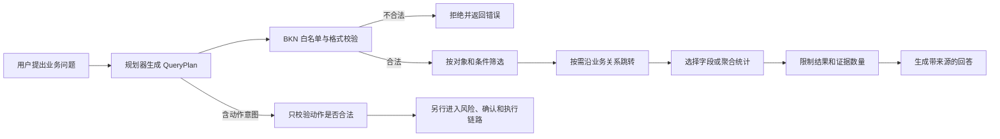

> Archive / 历史文档：保留当时的设计与评测记录；功能现状、启动命令和边界以根目录 [README](../../../README.zh.md) 为准。本机路径已去标识，历史命令不保证适用于当前版本。

# MiniBKN QueryPlan 通俗说明、当前进展与后续工作

> 更新日期：2026-08-17\
> 事实依据：当前源码、S4 开发报告、S3–S10 最终验收报告

## 1. 先说结论：你的理解对了一部分

你的理解是：用户问题可能不明确或不适合直接检索，于是系统扩展问题、提取关键词，再去搜索。这个想法合理，但它更接近“查询改写和关键词扩展”，不是当前 QueryPlan 的主要职责。

MiniBKN 的 QueryPlan 更像一张由 AI 填写、由程序严格审核并执行的“业务查询工单”：

> 把一句人话翻译成系统可执行的步骤，明确查哪类对象、按什么条件筛选、沿什么关系查找、做什么统计、返回多少结果，以及是否包含动作请求。

例如“已支付且金额超过一万元的订单总额是多少”，QueryPlan 不只是提取“订单、支付、一万元”，而是要求系统：查订单，筛选已支付和金额不低于 10,000 的记录，再对金额求和并返回证据。

## 2. 三个容易混淆的概念

| 概念 | 通俗比喻 | 解决的问题 | 当前状态 |
| --- | --- | --- | --- |
| 查询改写 | 把用户的话重新说清楚 | 简称、同义词、指代和复杂表达 | 已完成 LLM 初版和规则降级 |
| 普通检索 | 按关键词或语义找材料 | 哪些内容可能和问题有关 | 已有 BM25、向量和 RRF 混合检索 |
| QueryPlan | 写一张可执行查询工单 | 具体查什么、怎么算、沿哪条关系走 | 格式、校验、执行和 LLM 规划初版已完成 |

当前 `/search` 主要走普通检索；`/query-plans/*` 和 `/ask-planned` 走结构化计划。

## 3. 当前完整流程



- **规划层**：把自然语言变成 QueryPlan。可使用外部 OpenAI-compatible LLM；没有配置时使用简单规则规划器。
- **执行层**：不再自由理解语言，只按已验证的计划做确定性查询。这层已经具备过滤、关系跳转和聚合等核心能力。

## 4. 一张 QueryPlan 现在能写什么

| 项目 | 含义 | 当前支持情况 |
| --- | --- | --- |
| `intent` | 搜索、精确查找、关系跳转、聚合或动作 | 已支持五类枚举 |
| `object_types` | 查客户、订单还是其他对象 | 已支持 |
| `select` | 最后展示哪些字段 | 已支持 |
| `filters` | 状态、金额、日期等条件 | 支持等于、大小比较、集合、模糊和存在性等 |
| `traversals` | 沿哪种关系、哪个方向查 | 支持最多五跳 |
| `aggregates` / `group_by` | 计数、求和、平均、最值和分组 | 已支持 |
| `order_by` | 排序要求 | 聚合结果已支持；普通明细排序仍需补齐 |
| `limit` | 最多返回多少行 | 1–100 行 |
| `evidence_budget` | 证据条数和 Token 预算 | 已有契约；当前主要落实证据条数 |
| `answer_mode` | 文本、表格或列表 | 已有字段；展示层尚未充分区分 |
| `action_request` | 想执行什么动作 | 可校验，但不会在查询执行器中直接执行 |

对象、字段、关系和动作都必须存在于已发布 BKN。模型不能自行发明字段，也不能生成任意 SQL 或代码让系统执行。

## 5. 例子一：订单金额统计

用户问：“已支付并且金额大于等于一万元的订单，总金额是多少？”

理想规划器生成：

```json
{
  "version": "1.0",
  "intent": "aggregate",
  "object_types": ["order"],
  "filters": [
    {"field": "order.status", "operator": "eq", "value": "paid"},
    {"field": "order.amount", "operator": "gte", "value": 10000}
  ],
  "aggregates": [
    {"function": "sum", "field": "order.amount", "alias": "total_amount"}
  ],
  "limit": 10
}
```

程序会核对 BKN 中是否存在这些对象和字段，筛选订单，求和，然后返回统计值与参与计算的证据。它不会让大模型自己心算，也不会让模型临时编 SQL。

但要区分三种情况：

- 直接提交上面的 QueryPlan，当前执行器能够完成。
- 配置 OpenAI-compatible LLM 后，系统会要求模型生成 JSON，再进行白名单校验。
- 没有 LLM 时，规则规划器通常只能认出“订单”和“这是统计问题”，而且默认生成 `count`；它**不能可靠提取 `paid`、10,000 和 `sum(amount)`**。

所以，“能执行复杂计划”已完成，“只凭任意一句人话稳定生成正确复杂计划”尚未完成。

## 6. 例子二：沿关系查客户

用户问：“ORD-001 这笔订单是哪个客户下的？”

理想计划是先筛选 `order.order_id = ORD-001`，再沿 `placed_by` 关系向外走一跳，返回订单、客户和关系证据。关键部分如下：

```json
{
  "intent": "traverse",
  "object_types": ["order"],
  "filters": [
    {"field": "order.order_id", "operator": "eq", "value": "ORD-001"}
  ],
  "traversals": [
    {"relation": "placed_by", "direction": "out", "max_hops": 1}
  ],
  "limit": 10
}
```

执行器支持这类明确计划，也会拒绝不存在的关系。但默认规则规划器还不能稳定地从自然语言中提取编号、关系和方向。

## 7. 问题含糊时，当前会不会主动追问

现在已经支持“发现歧义 → 返回追问 → 用户带答案再次提交 → 生成计划”，同时返回改写问题、关键词、Schema 感知同义词和子问题。当前采用无状态接口，客户端需要在第二次请求中同时携带原问题和答案。

例如“最近那些大的客户怎么样”，系统会识别出：最近是 7 天还是本季度、大是按订单额还是客户等级、“怎么样”是要名单还是统计等待确认项，并在生成计划前追问。

## 8. 当前进展

| 能力 | 状态 | 说明 |
| --- | --- | --- |
| QueryPlan 格式与 BKN 白名单 | 已完成 | 额外字段、未知对象/字段/关系/动作会被拒绝 |
| 条件过滤、关系跳转、聚合 | 已完成 | 常见条件、最多五跳、五种聚合 |
| 证据与三个 API | 已完成核心链路 | 支持预览、执行和计划式问答 |
| LLM 规划适配器 | 已完成并实测 | DeepSeek 已通过本机密钥文件和端到端演示 |
| 无 LLM 规则规划器 | 初级可用 | 只做名称匹配和统计词判断，统计默认 count |
| 自然语言规划真实评测 | 已完成小规模首轮 | 14 题 CRM 冻结集 v2 为 1.000；仍需多行业盲测 |
| 查询改写、同义词、子问题拆解 | 已完成初版 | 由 DeepSeek 输出，规则规划器提供有限降级 |
| 歧义识别与自动追问 | 已完成初版 | 返回追问，补充答案后重新规划；暂为无状态交互 |
| QueryPlan 动作直接执行 | 刻意禁止 | 动作必须另走 S5 风险门禁、确认、幂等和审计 |

### “QueryPlan 准确率 1.000”到底代表什么

S10 的 130 题 1.000 仍然只代表执行器。2026-08-17 新增的 14 题自然语言 CRM 冻结集则专门测规划器：首轮严格准确率 0.50，收紧提示约束后在同一集合复跑为 1.00。由于题量小且参与了提示词调优，该结果不能外推为任意问题 100%，下一步必须增加未参与调优的多行业盲测。

## 9. 还剩哪些开发工作

S3–S10 已按上一轮范围完成，但整个产品尚未达到生产级。

### P0：2026-08-17 已完成第一轮

1. **S2 主外键发现**：已增加字段剖析、组合主键、外键值域覆盖、评分和候选理由；候选审核 API/UI 仍待补充。
2. **QueryPlan 自然语言增强**：已接 DeepSeek，加入改写、同义词、子问题和歧义追问，并建立 14 题冻结集；仍需多行业盲测。
3. **真实语义 Embedding**：已接通硅基流动 BGE-M3 并完成端到端 CRM 冒烟；尚未复跑原 200 题正式评测。
4. **BM25 性能**：已缓存语料分词和文档频率；仍需大数据性能对比和持久化缓存。

### P1：补成完整产品闭环

1. 加入 Reranker，与 BM25、Embedding 和 RRF 公平对照；
2. 为错误计划增加自动修复、降级和人工确认；
3. 完善普通明细排序、关系跳转后的二次过滤和 `answer_mode`；
4. 把动作意图衔接到风险模拟、人工确认和执行界面；
5. 加入真实身份、角色权限和企业认证；
6. 完善建模界面的字段修改、差异对比和动作/风险表单；
7. 配置评测 LLM，补测 Ragas Faithfulness；
8. 做三层上下文消融实验，验证 Token 是否真的下降。

### P2：扩展和生产化

1. **LightRAG 文档分支**：目前只有统一端口、禁用适配器和路由，无真实文档入库与查询；
2. **大规模增量构建**：异步任务、断点续建、版本原子切换和监控；
3. **可观测性**：记录规划、检索、证据、Token、费用、风险和延迟；
4. **部署与安全**：密钥管理、限流、备份、数据隔离和审计导出；
5. **真实业务验证**：在 CRM 外增加采购、财务、人事等场景。

## 10. 如何亲自查看 QueryPlan

后端启动且已有知识网络后，在 `http://127.0.0.1:8000/docs` 使用：

| 接口 | 用途 |
| --- | --- |
| `POST /api/v1/networks/{network_id}/query-plans/preview` | 输入问题，只生成和校验计划 |
| `POST /api/v1/networks/{network_id}/query-plans/analyze` | 返回改写、关键词、子问题、歧义追问和可选计划 |
| `POST /api/v1/networks/{network_id}/query-plans/execute` | 提交明确计划并执行 |
| `POST /api/v1/networks/{network_id}/ask-planned` | 生成计划、执行并返回回答与证据 |

预览请求：

```json
{"question": "已支付且金额超过一万元的订单总额是多少？"}
```

建议先用 `preview` 检查计划，尤其在未配置真实 LLM 时，不应把简单规则生成的计划直接视为正确答案。

## 11. 一句话总结

当前 MiniBKN 已造好“安全、可验证的业务查询执行器”，也预留了 AI 把人话翻译成计划的入口；下一阶段真正要攻克的是让 AI 在复杂、含糊和多跳问题上稳定写对计划，并用真实测试集证明准确率。
