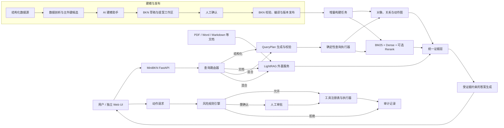

> Archive / 历史文档：保留当时的设计与评测记录；功能现状、启动命令和边界以根目录 [README](../../../README.zh.md) 为准。本机路径已去标识，历史命令不保证适用于当前版本。

# MiniBKN 通用化与 AI 全流程增强项目执行方案

> 文档版本：v1.0\
> 编写日期：2026-08-15\
> 适用基线：MiniBKN 0.4.0\
> 状态：已批准并进入实施，S0–S1 已完成\
> 目标：把当前供应链演示版升级为可覆盖常见企业场景、可安全执行动作、可量化评测的求职项目。

## 一、结论先行

这 11 项优化整体可行，但不适合同时开工。它们实际可以收敛为七条工作线：

1. 通用业务建模与版本管理；
2. AI 辅助建模与人工审核；
3. 数据发现、主外键识别和增量构建；
4. Embedding、QueryPlan 与结构化检索；
5. 通用风险规则和动作执行；
6. LightRAG 非结构化知识分支与统一路由；
7. 简单 UI、真实 CRM 数据集和完整评测。

推荐的开发原则是：**AI 负责提出建议、解释原因和生成计划；确定性的程序负责校验、发布、执行和审计。** AI 不能绕过风险规则，不能直接生成任意 SQL 或 Python 后执行，也不能把“推荐动作”自动变成“真实动作”。

为了秋招，最优先展示的不是功能数量，而是一条可验证的完整故事：

> 上传 CRM 表格 → AI 发现字段和表关系 → 人工确认并发布 BKN → 增量构建知识网络 → LLM 生成 QueryPlan → BM25 与向量混合检索 → 图关系查询和聚合 → 给出带证据回答 → 用户发起动作 → 风险规则拦截或进入审批 → 全程可追踪 → 用冻结测试集和 Ragas/检索指标证明效果。

LightRAG 和 UI 有展示价值，但应排在通用核心、QueryPlan、风险规则和结构化评测之后。

## 二、当前版本审计：为什么需要改

| 用户提出的方向 | 当前 0.4.0 的实际情况 | 本轮目标 |
| --- | --- | --- |
| 脱离供应链演示 | 领域模型已较通用，但回答器仍硬编码库存、安全库存、供应商等词 | 删除领域硬编码，用 BKN、QueryPlan 和证据对象驱动回答 |
| AI 更多参与 | AI 主要用于补充字段描述，建模流程没有提案、审核和发布状态 | 建立 AI 建模工作台，所有 AI 结果先成为可审查提案 |
| 真实 Embedding | 默认用 128 维哈希向量，已有本地 SentenceTransformer 接口 | 增加硅基流动 Embedding 适配器、缓存、批处理和版本管理 |
| 主外键增强 | CSV 只看 `id`/`sku`/`*_id` 和单列唯一性；关系主要按同名字段推断 | 元数据优先 + 数据剖析 + 组合键 + 包含依赖 + LLM 解释 + 人工确认 |
| QueryPlan | 用户问题直接进入检索，缺少过滤、跳转、聚合等结构化计划 | LLM 生成受 BKN 约束的计划，校验后由确定性执行器运行 |
| 通用风险控制 | BKN 能保存风险条件，但执行器主要识别 `value_threshold` 和补货金额 | 设计安全风险 DSL、编译器、模拟器、冲突策略和审批门禁 |
| 增量更新 | 网络、图和搜索文档主要按 network 全量替换 | 建立资源版本、变更集、稳定键、依赖图和局部重建 |
| 全流程 AI 辅助 | 缺少完整的建模会话和确认流程 | 自然语言建模、字段映射、关系/动作/风险建议、漂移解释 |
| 简单 UI | 当前产品无 UI | 独立前端，参考 BKN Studio 的工作流而不是复制全部功能 |
| LightRAG | 当前只处理结构化数据 | 外置 LightRAG 服务处理文档，统一路由、证据格式和最终回答 |
| 测试与 Ragas | 200 题偏模板化，主要是供应链；现有结果不是完整 Ragas | 建设冻结 CRM 数据、真实问题、动作安全集、文档混合集和公平基线 |

## 三、目标系统架构



### 3.1 关键边界

- MiniBKN 是结构化业务事实的权威来源，也是路由、统一证据、最终回答和动作安全的总控层。
- LightRAG 只负责非结构化文档的索引与证据召回，不直接执行企业动作，不替代 MiniBKN 的风险引擎。
- UI 是独立产品应用，通过公开 API 使用 MiniBKN；不把页面逻辑塞进 Python 核心。
- BKN 描述对象、关系、动作和风险规则；真实工具实现保存在受控工具注册表中，不能把任意脚本写进 BKN 后执行。

## 四、工作线一：从供应链演示升级为通用企业引擎

### 4.1 通用模型能力

第一步不是增加更多行业关键词，而是让程序只依赖 BKN 模型：

- 对象：客户、订单、合同、员工、库存、发票、工单等都只是对象类型；
- 关系：购买、负责、属于、引用、审批、付款等都由 BKN 定义；
- 动作：创建、更新、发送、审批、退款等由动作声明和工具注册共同组成；
- 风险：由通用条件表达式描述，不在代码中写死供应链公式；
- 回答：从统一证据生成，不使用 `current_stock`、`supplier` 等特定字段分支。

需要补齐的数据类型包括 `date`、`datetime`、`decimal`、`enum`、`json`、可空性和组合键。字段显示名、同义词、业务含义、敏感级别、单位和时区也应成为正式元数据。

### 4.2 BKN 生命周期

引入四种状态：

`draft → reviewed → approved → published`

- AI 或程序生成的是草稿和提案；
- 用户逐项接受、修改或拒绝；
- 发布前完成结构、引用、类型、风险和工具绑定校验；
- 已发布版本不可原地修改，新修改生成新版本；
- 每次查询和动作都记录使用的 BKN 版本。

### 4.3 新的核心对象

- `ModelingSession`：一次建模会话；
- `SchemaProposal`：字段、主键、关系、动作或风险建议；
- `BknVersion`：可追踪的网络版本；
- `EvidenceItem`：统一检索证据；
- `QueryPlan`：结构化查询计划；
- `BuildJob` / `ChangeSet`：构建任务及变更范围；
- `RiskDecision`：规则命中、结论和解释；
- `DocumentRecord`：非结构化文档及版本。

## 五、工作线二：AI 全流程辅助，同时守住安全边界

### 5.1 AI 可以参与的位置

| 阶段 | AI 做什么 | 程序和人工如何兜底 |
| --- | --- | --- |
| 数据接入 | 解释表格用途、字段含义和异常 | 统计结果由程序计算，AI 不修改原始数据 |
| Schema 建模 | 推荐对象、字段映射、显示名、同义词和描述 | Pydantic/BKN 校验，用户确认后才能发布 |
| 主外键/关系 | 对候选关系重新排序并解释依据 | 候选来自确定性剖析；不得凭空创建已确认关系 |
| 动作设计 | 根据自然语言起草动作参数、返回值和工具需求 | 工具必须由开发者注册，参数类型和权限必须校验 |
| 风险设计 | 起草风险规则、说明缺失条件、生成测试样例 | 安全 DSL 编译；模拟通过且人工批准后发布 |
| 查询 | 判断意图，生成 QueryPlan，选择结构化/文档/混合路线 | 计划必须通过 BKN 白名单、复杂度和权限检查 |
| 回答 | 汇总证据、说明不确定性、给出引用 | 只能引用统一证据；证据不足时明确拒答 |
| 运维 | 解释 Schema 漂移、构建失败和评测退化 | 只提供诊断和建议，不能自行改变生产模型 |

### 5.2 明确禁止 AI 直接做的事

- 直接执行任意 SQL、Python、Shell 或用户提供的代码；
- 绕过工具注册表调用外部系统；
- 自己宣布风险“通过”并执行动作；
- 未经确认发布推断的主外键、动作或风险规则；
- 将提示词中的文字当成权限证明；
- 修改或删除审计记录；
- 文档证据触发业务动作。

### 5.3 提案机制

每条 AI 建议都保存：建议内容、置信度、证据、模型名称、提示词版本、时间、审核人、审核结果和修改记录。这样既方便用户，也能在面试中说明系统如何避免“AI 一句话改坏业务模型”。

## 六、工作线三：通用主键与外键识别

### 6.1 分层发现流程

1. **数据库元数据优先**：读取数据库声明的主键、外键、唯一约束和索引；声明约束的可信度最高。
2. **列级剖析**：计算空值率、唯一率、基数、类型、长度、格式、熵、稳定性和样例。
3. **候选主键发现**：先单列，再搜索最多三列的组合唯一键；避免组合爆炸。
4. **候选外键发现**：计算两个字段间的包含率、孤儿率、类型兼容、名称相似、值域重合和基数关系。
5. **语义重排**：LLM 只对已发现的候选做解释和排序，可使用脱敏样例，不能从零编造关系。
6. **人工确认**：展示支持证据、反例和影响范围，允许接受、修改、拒绝和锁定。
7. **持续验证**：新增数据进入后监控唯一性、孤儿率和 Schema 漂移。

### 6.2 建议评分

没有数据库声明时，可先用以下可解释评分作为初版：

```text
PK = 0.30×唯一率 + 0.20×非空率 + 0.15×名称特征
   + 0.15×跨批次稳定性 + 0.10×类型适合度 + 0.10×值分布质量

FK = 0.35×包含率 + 0.15×低孤儿率 + 0.15×名称相似
   + 0.15×类型兼容 + 0.10×基数合理性 + 0.10×语义一致性
```

阈值建议：

- 数据库明确声明：直接作为已声明约束导入；
- 推断分数 `≥ 0.90`：高置信候选，仍需用户确认；
- `0.70–0.90`：普通候选，必须展示证据人工选择；
- `< 0.70`：默认不推荐，只进入诊断列表。

实际权重必须用 CRM 和至少一个不同领域的数据验证后再固定。

### 6.3 必须处理的难点

- 组合主键和组合外键；
- 编码前缀、大小写、空格、前导零等规范化；
- 自然键与代理键并存；
- 多对多中间表；
- 历史数据中的孤儿记录；
- 同名不同义、异名同义；
- 一张表多个外键指向同一目标；
- 用户手工覆盖和“永不再推荐”记录。

## 七、工作线四：真实 Embedding、混合检索和 QueryPlan

### 7.1 硅基流动 Embedding 选型

首选建议：

| 用途 | 模型 | 理由 | 建议 |
| --- | --- | --- | --- |
| 默认 MVP | `BAAI/bge-m3` | 多语言、最长 8192 token、1024 维，官方价格页当前列为免费 | 第一阶段默认 |
| 可选重排 | `BAAI/bge-reranker-v2-m3` | 与 BGE-M3 组合，适合对混合召回结果二次排序 | 在消融实验中启用 |
| 长文本实验 | `Qwen/Qwen3-Embedding-0.6B` | 官方接口标注最长 32768 token，可指定不超过 1024 维 | API Key 到位后先查账户模型列表 |
| 质量上限实验 | `Qwen/Qwen3-Embedding-4B/8B` | 维度和模型更大 | 只作为效果/成本实验，不作为默认 |
| 中文短文本基线 | `BAAI/bge-large-zh-v1.5` | 中文效果成熟，但上下文上限较短 | 只做对照，不推荐主线 |

模型供应、账户权限和价格可能变化。拿到 Key 后先调用模型列表接口确认，不把未验证的价格写进简历。

### 7.2 实现要求

- 新增 `SiliconFlowEmbedder`，使用 OpenAI 风格的 `/v1/embeddings`；
- 支持批量请求、超时、重试、限流、熔断和错误降级；
- API Key 只放本地环境变量，不写入代码、文档或 Git；
- 用 `模型 + 维度 + 规范化版本 + 内容哈希` 作为向量缓存键；
- BM25 保留，默认采用 BM25 + Dense + RRF；
- 可选 Reranker 只重排 Top-N，不对全库运行；
- 记录 embedding token、请求次数、延迟和费用估算；
- 模型或维度变化时创建新索引版本，不能在旧索引内混写。

建议配置：

```dotenv
MINIBKN_EMBEDDING_PROVIDER=siliconflow
MINIBKN_EMBEDDING_API_BASE=https://api.siliconflow.cn/v1
MINIBKN_EMBEDDING_API_KEY=仅写在本地.env中
MINIBKN_EMBEDDING_MODEL=BAAI/bge-m3
MINIBKN_EMBEDDING_DIMENSIONS=1024
MINIBKN_EMBEDDING_BATCH_SIZE=32
MINIBKN_EMBEDDING_TIMEOUT_SECONDS=30
```

### 7.3 QueryPlan 设计

LLM 不直接生成 SQL，而是生成受约束的 JSON：

```json
{
  "intent": "aggregate",
  "object_types": ["customer", "order"],
  "select": ["customer.name"],
  "filters": [{"field": "order.created_at", "op": ">=", "value": "2026-01-01"}],
  "traversals": [{"relation": "customer_placed_order", "direction": "out"}],
  "aggregates": [{"fn": "sum", "field": "order.amount", "alias": "total_amount"}],
  "group_by": ["customer.id"],
  "order_by": [{"field": "total_amount", "direction": "desc"}],
  "limit": 10,
  "evidence_budget": {"max_items": 20, "max_tokens": 4000},
  "answer_mode": "table",
  "action_request": null
}
```

执行链路：

1. 获取用户权限范围和已发布 BKN；
2. LLM 生成计划；
3. Pydantic 校验 JSON；
4. 根据 BKN 检查对象、字段、关系和操作符白名单；
5. 检查跳数、扫描范围、聚合和上下文预算；
6. 确定性执行器运行过滤、图跳转和聚合；
7. 将原始事实、关系路径和计算结果都封装为证据；
8. LLM 只根据证据生成最终回答。

失败策略：计划不合法时只允许修复一次；再次失败则退回规则检索或明确说明无法执行，绝不把原始 LLM 文本当 SQL 执行。

## 八、工作线五：把风险控制变成 BKN 中的通用能力

### 8.1 BKN 可以保存什么

风险规则可以成为 BKN 的一部分，但保存的是**声明式条件和决策**，不是任意执行代码。建议字段：

- `risk_id`、版本、描述、优先级、生效时间；
- 适用动作和适用对象；
- 条件表达式树；
- 决策：`allow`、`confirm`、`deny`；
- 原因模板、审批角色和证据要求；
- 正例、反例和边界测试样例。

示例：

```yaml
risk_id: large_discount_requires_manager
applies_to_actions: [update_quote]
condition:
  and:
    - compare: {left: "$action.discount_rate", op: ">", right: 0.20}
    - compare: {left: "$subject.role", op: "!=", right: "sales_manager"}
decision: confirm
approval_roles: [sales_manager]
reason: "折扣超过 20%，需要销售经理审批"
```

### 8.2 安全执行方式

- 用白名单 AST/DSL 解析，禁止 `eval`；
- 只允许比较、逻辑、有限算术、集合包含和已注册的安全函数；
- 发布前做字段引用、类型、冲突和边界测试；
- AI 可起草规则和测试，但不能批准自己的规则；
- 冲突默认 `deny > confirm > allow`；
- 规则计算异常时 fail closed：不执行动作，返回需人工处理；
- 动作必须由用户明确提出或确认，AI 推荐不能自动执行；
- 工具调用需要权限、参数校验、幂等键、超时、回滚/补偿说明和审计日志。

### 8.3 风险模拟器

发布前允许用户输入若干动作参数，查看命中的规则、计算过程、最终结论和审批人。这既降低配置门槛，也是 UI 中很有价值的演示功能。

## 九、工作线六：增量更新而非全量重建

### 9.1 变更识别

为每个数据源记录：连接信息指纹、Schema 指纹、抽取游标、数据版本和最近成功构建版本。每条业务记录使用：

`稳定业务键 + 规范化内容哈希`

生成 `ChangeSet`：

- inserted：新稳定键；
- updated：稳定键相同但内容哈希变化；
- deleted：旧版本存在但新版本消失，或收到明确删除事件；
- unchanged：跳过图和向量更新。

### 9.2 局部影响计算

- 对象变化：只更新该对象的搜索文档和向量；
- 外键变化：重算该记录直接关联的边；
- 映射变化：沿依赖图找受影响对象、关系和索引；
- 描述变化：只重建包含该描述的搜索文档；
- 文档变化：按文档版本删除旧 chunks，再导入新版本；
- 删除使用 tombstone，确保图、索引和审计处理一致。

### 9.3 仍需全量重建的情况

- 主键或稳定键规则改变；
- 大范围字段映射或对象边界改变；
- Embedding 模型或维度改变且无双索引迁移；
- 图/索引校验发现损坏；
- 变更比例超过可配置阈值，例如初版可设 30%，评测后调整。

### 9.4 构建可靠性

构建采用任务状态机：`pending → profiling → materializing → indexing → validating → published/failed`。需要事务边界、检查点、重试、幂等、版本切换和失败回滚；只有完整校验通过的新版本才能替换在线版本。

## 十、工作线七：LightRAG 非结构化分支

### 10.1 推荐集成方式

将 LightRAG v1.5.6 作为**可关闭、版本固定的 REST sidecar**，不要嵌入 MiniBKN Python 进程。MiniBKN 负责文档登记、路由、权限、证据归一化和最终回答。

查询优先使用 LightRAG 的 `/query/data`，读取 entities、relationships、chunks 和 references，再转为 MiniBKN `EvidenceItem`；不直接采用 `/query` 生成的最终答案。这样结构化和文档证据能在同一层融合，也能统一做 Faithfulness 与引用校验。

### 10.2 路由类型

- `structured`：客户、订单、金额、聚合、状态和动作请求；
- `document`：制度、合同条款、产品说明和会议纪要；
- `hybrid`：结构化事实与文档规则同时需要；
- `auto`：路由器判断，并返回理由和置信度。

低置信度时可以双路召回，但动作始终只能基于已授权的结构化事实和风险规则。

### 10.3 隔离与风险

LightRAG Server 的 workspace 在实例初始化后不是按请求随意切换的。MVP 不应把多个 MiniBKN network 默认混入同一 workspace。初版采用“一 network 绑定一个固定 endpoint/workspace”，或者演示环境只允许一个网络。

还需建设：文档版本登记、解析状态、权限标签、删除同步、重复文件检测、来源页码/段落引用、服务不可用降级和超时预算。

更详细的专项设计见 [LightRAG 与评测可行性规划](MINIBKN_EVALUATION_LIGHTRAG_FEASIBILITY_AND_ROADMAP.md)。

## 十一、简单 UI 方案

参考 BKN Studio 的工作流和技术选择，建议新建独立 `minibkn-ui`：React、TypeScript、Vite、React Router、Ant Design、Axios、Vitest。初版只做六个页面：

1. **数据源**：上传 CSV/Excel、连接 SQLite、查看剖析状态；
2. **AI 建模向导**：展示对象、字段、主外键、关系、动作和风险提案；
3. **网络预览**：查看 BKN Schema、关系图、版本差异并发布；
4. **问答与 QueryPlan 调试**：查看路由、计划、证据、Token 和回答；
5. **动作与风险模拟**：填写参数、查看规则命中、确认/审批；
6. **构建与评测面板**：查看增量构建任务、错误、指标和基线对比。

UI 不复制 BKN Studio 全量后台能力，也不增加页面专用 BFF；它直接调用 MiniBKN 公共 API。先保证完整演示链路，再优化图形编辑器和视觉效果。

## 十二、CRM 数据集与完整评测方案

### 12.1 数据集设计

建立固定随机种子和 `as_of` 时间的模拟 CRM：

- 约 500 名客户；
- 2,000–3,000 个订单；
- 6,000–10,000 条订单明细；
- 100–150 个产品；
- 15–30 名销售；
- 500–1,000 条工单或跟进记录；
- 加入少量可解释的空值、重复、孤儿键、状态变化和边界金额。

数据生成器、Schema、随机种子和数据哈希都进入版本控制，但不把最终答案临时改成迎合系统输出。

### 12.2 冻结问题集

- `crm_dev_40`：开发调试使用，不能报告为最终结果；
- `crm_eval_200_v1`：冻结评测集：
  - 单对象查询 70 题；
  - 多跳关联查询 70 题；
  - 条件过滤/聚合统计 60 题；
- 另外标注无答案、噪声、时间范围和歧义问题；
- `crm_action_30_v1`：动作参数、权限、风险、审批、幂等和失败回滚；
- `mixed_knowledge_100_v1`：40 文档题、40 混合题、20 路由/无答案/降级题。

问题不能只靠模板替换实体名称。至少由一轮人工业务审查确认问题自然、答案唯一或答案规则明确、证据可定位。

### 12.3 公平基线

结构化 CRM 统一比较：

- B0：BM25；
- B1：Dense-only，使用相同 Embedding；
- B2：BM25 + Dense + RRF；
- B3：B2 + Reranker；
- B4：MiniBKN QueryPlan + 图关系 + 三层渐进上下文。

文档集另外比较：

- 扁平向量文档 RAG；
- LightRAG；
- MiniBKN 结构化分支 + LightRAG 混合路由。

不要拿 LightRAG 与结构化 CRM 图查询直接比较后宣称谁全面更好，因为两者目标不同。

### 12.4 指标体系

| 层面 | 指标 |
| --- | --- |
| 检索 | Hit@K、MRR、nDCG@5、Context Precision、Context Recall |
| 回答 | Exact Match、字段 F1、聚合准确率、Ragas Faithfulness、Answer Relevancy |
| 引用 | 引用有效率、引用覆盖率、来源定位正确率 |
| 路由 | Accuracy、Macro-F1、混淆矩阵、低置信度覆盖率 |
| 动作 | 工具选择、参数正确率、风险决策、审批门禁、幂等和拒绝准确率 |
| 性能 | P50/P95 延迟、Embedding/LLM Token、请求次数、费用估算、上下文 Token |
| 增量 | 变更识别准确率、局部构建时间、重算比例、线上版本切换时间 |

当前已有的 IDBasedContextPrecision@1 与 Ragas Context Precision 不是同一个指标，后续报告必须保留原名，不能直接改名。

### 12.5 实验纪律

- 各基线使用相同 LLM、提示词、Top-K 和上下文预算；
- LLM/Judge 指标运行三次，报告均值和标准差；
- 使用配对 bootstrap 或同类方法给出差异置信区间；
- 每次结果保存代码提交、配置、模型、数据哈希、问题集版本和原始输出；
- 0.78、0.89、Token 降低 36% 等简历数字只有在真实复现实验后才能使用。

## 十三、建议代码与 API 结构

### 13.1 Python 模块

```text
src/minibkn/
├─ domain/
│  ├─ modeling.py       # 提案、审核、BKN 版本
│  ├─ query.py          # QueryPlan
│  ├─ evidence.py       # 统一证据
│  ├─ policy.py         # 风险 DSL 与决策
│  └─ build.py          # BuildJob、ChangeSet
├─ ports/
│  ├─ embedding.py
│  ├─ planner.py
│  ├─ answer_generator.py
│  └─ document_knowledge.py
├─ adapters/
│  ├─ embedding/siliconflow.py
│  ├─ llm/query_planner.py
│  └─ document/lightrag_client.py
└─ application/
   ├─ modeling_service.py
   ├─ incremental_build_service.py
   ├─ query_orchestrator.py
   ├─ policy_service.py
   └─ evaluation_service.py
```

### 13.2 建议新增 API

```text
POST  /api/v1/modeling-sessions
POST  /api/v1/sources/{source_id}/profile
POST  /api/v1/modeling-sessions/{id}/generate
PATCH /api/v1/modeling-sessions/{id}/proposals/{proposal_id}
POST  /api/v1/modeling-sessions/{id}/publish

POST  /api/v1/networks/{network_id}/builds
GET   /api/v1/builds/{build_id}

POST  /api/v1/networks/{network_id}/query-plans/preview
POST  /api/v1/networks/{network_id}/ask-routed

POST  /api/v1/networks/{network_id}/risks/{risk_id}/simulate

POST  /api/v1/networks/{network_id}/documents
GET   /api/v1/networks/{network_id}/documents/{document_id}
DELETE /api/v1/networks/{network_id}/documents/{document_id}
```

新功能先放在 `experimental` 配置下，原 0.4.0 API 保持兼容，成熟后再提升为默认路径。

## 十四、分阶段执行路线

| 阶段 | 主要交付 | 预计有效开发日 | 验收门槛 |
| --- | --- | ---: | --- |
| S0 基线与契约 | 冻结现有行为；定义 Evidence、QueryPlan、BKN 版本、BuildJob 契约 | 2–3 | 原测试全过；新契约测试可运行 |
| S1 通用核心 | 删除供应链硬编码；通用类型；证据驱动回答；版本状态 | 4–6 | 用 CRM 和供应链两套小数据完成同一条问答链路 |
| S2 数据发现 | 完整剖析、组合键、主外键候选、审核记录 | 6–8 | 带噪声 CRM 的 PK/FK 指标达到事先约定阈值 |
| S3 Embedding | 硅基流动适配、缓存、批处理、索引版本、混合召回 | 3–5 | Key 不落盘；可复现实验；服务失败可降级 BM25 |
| S4 QueryPlan | 计划生成、校验、图跳转、过滤、聚合、证据预算 | 7–10 | 单对象、多跳、聚合均可端到端回答；无任意 SQL |
| S5 风险与动作 | 风险 DSL、模拟、审批、权限、幂等、审计 | 5–7 | 允许/确认/拒绝与失败关闭测试全部通过 |
| S6 增量构建 | 指纹、ChangeSet、依赖分析、局部更新、版本切换 | 6–8 | 单表少量变化不再全量重建，删除和回滚一致 |
| S7 AI 建模工作流 | 自然语言建模、提案审核、动作/风险建议、漂移解释 | 5–7 | AI 产物未经确认不可发布；所有提案可追踪 |
| S8 LightRAG | 文档登记、sidecar、路由、统一证据、混合查询 | 5–7 | 文档/结构化/混合三路可测；文档不能触发动作 |
| S9 UI | 六页简单前端和演示脚本 | 5–7 | 新用户可不碰命令行走完核心流程 |
| S10 正式评测 | CRM/动作/文档集、基线、Ragas、Token 与报告 | 7–10 | 冻结数据和配置可一键复现，结果有原始记录 |

总量约 55–78 个有效开发日。AI 辅助下可以并行压缩，但数据审核、安全测试和正式评测不应省略。

### 14.1 面向秋招的优先顺序

**P0：先形成可信核心**

`S0 → S1 → S2 → S3 → S4 → S5 最小版 → S10 结构化评测`

这能支撑简历中的通用建模、混合检索、QueryPlan、风险动作和真实指标。

**P1：形成完整产品演示**

`S6 → S7 → S9`

**P2：扩展非结构化能力**

`S8 → S10 文档/混合评测`

不建议为了 UI 或 LightRAG 展示，推迟 QueryPlan、风险安全或正式评测。

## 十五、每阶段统一开发流程

1. 明确用户故事、输入输出和不可做事项；
2. 先写领域契约、API 和验收测试；
3. 实现最小纵向链路；
4. 增加错误、权限、安全和降级测试；
5. 用固定小数据跑端到端；
6. 更新架构、开发记录、通俗报告和 AI 交接文档；
7. 展示工作区 diff，由用户验收后再进入下一阶段；
8. 正式指标只从冻结评测流程产生。

每阶段至少产出：代码、测试、配置示例、API 示例、技术开发记录、非技术报告、已知限制和下一阶段入口。

## 十六、环境变量与用户后续需要提供的内容

用户暂时不需要在方案阶段提供 Key。进入 S3 时需要：

- 一个硅基流动 API Key，仅写入本地 `.env`；
- 确认账户可调用的 embedding/reranker 模型列表；
- 如启用 LLM QueryPlan/回答，提供一个 OpenAI-compatible LLM Endpoint/Key；
- 如启用完整 Ragas，确认评测 Judge/Embedding 模型及预算；
- 如启用 LightRAG，确认本地 Docker/服务运行方式和文档样本。

严禁把真实 Key 粘贴进 Markdown、测试快照或提交记录。配置日志也必须遮盖 Key。

## 十七、总体验收标准

### 功能

- 供应链和 CRM 使用同一套引擎，不存在领域专属回答分支；
- AI 能生成可解释、可修改、可拒绝的建模提案；
- 主外键支持元数据、单列、组合键、噪声和人工覆盖；
- QueryPlan 支持单实体、关系跳转、过滤和聚合；
- 风险规则来自 BKN，能安全编译、模拟、拦截和审批；
- 小规模数据变化走增量更新；
- 文档通过 LightRAG 进入统一证据层；
- UI 能完成核心演示路径。

### 安全

- 无任意代码/SQL 执行；
- AI 无法自行发布模型、批准风险或执行动作；
- 失败默认不执行动作；
- 权限、审批、幂等和审计有自动化测试；
- Secret 不进入仓库和报告。

### 评测

- 冻结 CRM、动作和文档测试集；
- 有 BM25、Dense、RRF、Rerank、QueryPlan/图检索对比；
- 报告完整检索、回答、Faithfulness、路由、动作、Token、延迟和成本；
- 所有简历数字可由版本化命令重现。

## 十八、主要风险与非目标

### 主要风险

- 过度依赖 LLM 生成 Schema 会产生“看起来合理、实际错误”的关系；
- 增量更新与版本切换比全量重建更复杂，必须先建立稳定键；
- Ragas Judge 会受模型和提示词影响，不能只报告一个分数；
- LightRAG 的 workspace 隔离和删除同步需要额外运维；
- 同时支持过多数据库、文件格式和企业权限会失控。

### 当前非目标

- 不做生产级多租户 SaaS；
- 不做任意 SQL 工作台；
- 不做任意代码型动作；
- 不复制完整 BKN Studio；
- 不承诺所有行业开箱即用，而是证明核心机制能迁移到至少两个不同领域；
- 不在真实评测前预设简历提升数字。

## 十九、推荐的第一批实施内容

本方案经用户确认后，第一批只进入 S0：

1. 冻结 0.4.0 基线和现有测试结果；
2. 定义 `EvidenceItem`、`QueryPlan`、`SchemaProposal`、`BknVersion`、`BuildJob`；
3. 建立最小 CRM 数据样例和供应链回归样例；
4. 为“移除供应链硬编码”先写失败测试；
5. 输出 API 契约和迁移说明；
6. 评审通过后才实现 S1。

这样可以避免一开始把 Embedding、LightRAG、UI 和风险引擎混在一次大改中。

## 二十、资料依据

- [BKN Foundry 仓库](https://github.com/openbkn-ai/bkn-foundry)：BKN 对象、关系、动作、风险与 Foundry 服务基础。
- [BKN Studio 仓库](https://github.com/openbkn-ai/bkn-studio)：UI 工作流和 React/TypeScript/Vite 等技术选择参考。
- [硅基流动 Embeddings API](https://docs.siliconflow.cn/en/api-reference/embeddings/create-embeddings)：模型、最大上下文和可选维度。
- [硅基流动价格页](https://siliconflow.cn/pricing)：当前模型价格状态；实施时仍需以账户模型列表和实时价格为准。
- [BGE-M3 模型卡](https://huggingface.co/BAAI/bge-m3)：多语言、1024 维、8192 token 和混合检索能力。
- [Qwen3 Embedding 官方介绍](https://qwenlm.github.io/blog/qwen3-embedding/)：Qwen3 Embedding/Reranker 系列和多语言检索能力。
- [SQLAlchemy Reflection](https://docs.sqlalchemy.org/en/20/core/reflection.html)：数据库主键、外键和唯一约束反射。
- [HyUCC](https://www.btw2017.informatik.uni-stuttgart.de/slidesandpapers/F3-13-21-short/paper_web.pdf)：唯一列组合发现方法参考。
- [SINDY](https://hpi.de/fileadmin/user_upload/fachgebiete/naumann/publications/2015/Scaling_out_the_discovery_of_INDs-CR.pdf)：包含依赖和外键候选发现参考。
- [Great Expectations：Uniqueness](https://docs.greatexpectations.io/docs/reference/learn/data_quality_use_cases/uniqueness/) 与 [Integrity](https://docs.greatexpectations.io/docs/reference/learn/data_quality_use_cases/integrity/)：持续数据质量验证参考。
- [LightRAG v1.5.6](https://github.com/HKUDS/LightRAG/releases/tag/v1.5.6) 与 [`/query/data` 实现](https://github.com/HKUDS/LightRAG/blob/v1.5.6/lightrag/api/routers/query_routes.py)：非结构化 sidecar 和证据级查询依据。
- [Ragas Context Precision](https://docs.ragas.io/en/stable/concepts/metrics/available_metrics/context_precision/)、[Context Recall](https://docs.ragas.io/en/stable/concepts/metrics/available_metrics/context_recall/)、[Faithfulness](https://docs.ragas.io/en/stable/concepts/metrics/available_metrics/faithfulness/) 与 [Datasets](https://docs.ragas.io/en/stable/concepts/datasets/)：正式评测设计依据。

## 二十一、文档关系

- 本文是后续优化的总执行大纲和当前主计划。
- 既有的 [项目复现方案](MINIBKN_REPRODUCTION_PLAN.md) 记录 0.4.0 的起点和开发阶段。
- [LightRAG 与评测可行性规划](MINIBKN_EVALUATION_LIGHTRAG_FEASIBILITY_AND_ROADMAP.md) 是对应专项的补充材料。
- 代码边界以 [架构文档](../ARCHITECTURE.md) 为准；当前验收以 [验收文档](../ACCEPTANCE.md) 为准。
