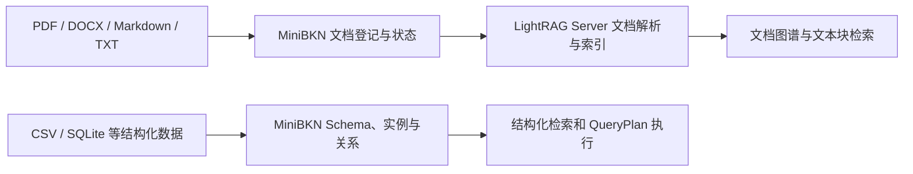
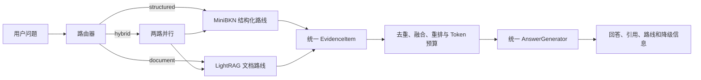
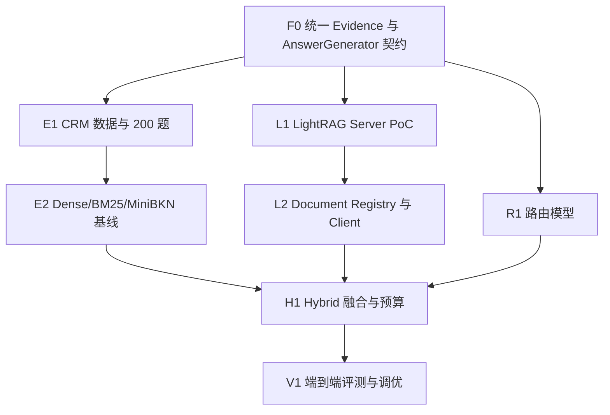
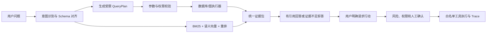

> Archive / 历史文档：保留当时的设计与评测记录；功能现状、启动命令和边界以根目录 [README](../../../README.zh.md) 为准。本机路径已去标识，历史命令不保证适用于当前版本。

# MiniBKN 评测深化与 LightRAG 并行检索可行性分析及后续规划

> 文档版本：1.0\
> 编写日期：2026-08-12\
> 当前状态：方案已完成，功能尚未开始实现\
> 适用对象：项目本人、后续接手开发的 AI、代码审查者与面试材料整理者

## 0. 文档用途

本文件同时承担三项职责：

1. 完整保存本次关于“继续完成 Ragas 评测”和“接入 LightRAG 非结构化并行路线”的答复；
2. 为后续开发者提供可以直接拆成 Issue、设计文档和验收任务的实施规划；
3. 在文末完整归档上一轮“秋招项目优化总监方案”原文，避免规划散落在聊天记录中。

本文件只是一份分析与规划。除创建本 Markdown 文件外，本轮没有开始实现 Ragas 新评测、CRM
数据集、LightRAG、路由器或其他业务代码。

### 0.1 事实与口径优先级

后续开发者遇到描述冲突时，按下面的优先级判断事实：

```text
当前代码、测试和原始评测结果
> 最终验收报告
> 本规划的最新版主体
> 历史回答原文
> 简历目标截图
```

本文件中的状态含义：

- **[已实现]**：代码路径已经存在；
- **[已实测]**：存在可复算的原始运行结果；
- **[规划]**：已经设计但尚未开发；
- **[目标值]**：希望通过实验达到，不代表已经实现；
- **[未验证]**：依赖外部模型、服务或环境，仍需 PoC。

当前事实基线：

- [已实现] MiniBKN 0.4.0 主链路、MCP、API Key、自动 Schema、风险门禁和 Trace；
- [已实测] 13 项测试通过，当前供应链图只有 5 个对象、3 条关系和 9 个检索文档；
- [已实测] 当前 200 条是模板化供应链检索回归集，只运行了 ID Context Precision；
- [未验证] 通用 CRM 问答、Faithfulness、真实语义模型完整对比、Token 降幅和 LightRAG；
- [目标值] 0.78、0.89、36% 均属于未来实验目标。

当前供应链回归集得到的约 `0.515` 与截图中 CRM 基线 `0.51` 只是数值接近，两者不是同一个任务、
数据集或指标实现，不能把前者改名后当作后者的实验基线。

---

# 第一部分：本次答复——评测深化与 LightRAG 并行路线

## 1. 总体结论

两个方向都可行，而且组合后比单独增加 LightRAG 更有价值：

- **继续完成截图中的评测目标：高可行性。** 当前 MiniBKN 已有评测脚本、固定数据集、完整排名
  和 Ragas 依赖，可以继续建设；真正困难的是建立可信的 CRM 数据、标准答案和公平实验，而不是
  调用 Ragas 本身。
- **LightRAG 作为非结构化文件并行路线：中高可行性。** 推荐把 LightRAG 部署为独立、可关闭的
  Server，通过官方 REST API 接入 MiniBKN，不把 LightRAG 内部代码直接嵌入核心。
- **两条路线可以并行开发，但不能完全独立。** 它们必须先共享统一的证据模型、引用规则和回答
  生成边界，最后才能进行结构化、文档和混合问题的公平评测。

截图中的三个数字：

```text
Context Precision：0.51 → 0.78
Faithfulness：0.81 → 0.89
平均上下文 Token：降低 36%
```

应被定义为**实验目标或挑战目标**，不能被当成已经实现的结果。最终简历必须使用冻结测试集上
真实运行出来的数字，即使结果没有恰好达到 0.78、0.89 或 36%。

推荐总体工期：

- 最小 PoC：7～10 个有效开发日；
- 完整评测与 LightRAG 路由：约 25～32 个有效开发日；
- 如果每天只能投入约 2 小时：建议按 8～10 周安排。

## 2. 与上一轮路线的关系

本规划不是推翻上一轮方案，而是在其基础上的专项扩展。

必须保留上一轮确定的先后关系：

```text
项目正式化
→ 通用证据与回答边界
→ 真实检索基线
→ CRM 可信评测
→ LightRAG 文档路线
→ 自动路由与并行融合
→ 完整端到端对比
```

不能直接把 LightRAG 接到当前 `/ask` 后面。当前回答仍包含供应链字段硬编码；如果不先统一证据和
回答接口，最终会出现两套回答逻辑、两套引用格式，评测也无法公平比较。

## 3. 当前评测离截图目标还差什么

当前 200 条数据是五个实体的模板化检索回归集，主要验证某个实例文档能否排到第一名。它不能
充分支持截图中的陈述，原因包括：

1. 没有真正的电商 CRM 数据模型；
2. 没有覆盖单实体、多跳关联、聚合统计三类执行结果；
3. 当前 `IDBasedContextPrecision@1` 基本等价于 Hit@1；
4. 当前回答只对库存问题有确定性业务逻辑；
5. 没有真实答案生成，因此无法测量可信的 Faithfulness；
6. 没有记录回答模型的真实 Prompt Token；
7. 没有定义“传统向量 RAG”与“MiniBKN”的公平对比条件；
8. 没有冻结的开发集、验证集和隐藏测试集。

因此新评测不能只修改一个脚本，而需要同时完成：CRM 场景、通用查询/回答、统一证据、真实模型
和版本化实验。

## 4. 目标系统架构

### 4.1 数据导入路线



### 4.2 查询路线



### 4.3 行动边界

LightRAG 只能提供文档证据，不能成为业务事实数据库，也不能直接触发工具。

```text
LightRAG 检索到“可以退款”
≠ 系统自动执行退款

用户明确请求行动
→ 映射到真实 MiniBKN 对象
→ 参数校验
→ 身份/风险判断
→ 人工确认（如需要）
→ 白名单工具
→ Trace
```

任何从文档抽取出来的实体和关系，在进入权威 BKN Schema 前都应视为“候选知识”，需要映射、
置信度判断或人工确认。

---

## 5. 路线 A：CRM 200 题与 Ragas 评测

## 5.1 评测目标拆解

截图中的一句话实际包含四个不同实验：

1. 构建 CRM 业务数据和 200 道有标准答案的问题；
2. 比较传统 Dense Vector RAG 与 MiniBKN 检索的上下文质量；
3. 比较两个系统生成答案的 Faithfulness；
4. 比较普通 Top-K 上下文与三层渐进式上下文的 Prompt Token。

这四项必须分别测量，最后再形成端到端结论，不能只运行一个 Ragas 总分。

## 5.2 CRM 场景建议

推荐使用下面六类核心对象：

| 对象 | 主要字段示例 |
| --- | --- |
| Customer | 客户编号、等级、地区、注册时间、销售负责人 |
| Order | 订单编号、客户编号、时间、状态、金额 |
| OrderItem | 订单编号、商品编号、数量、成交价 |
| Product | 商品编号、品类、标准价格、库存 |
| SalesRep | 销售编号、姓名、团队、区域 |
| ServiceTicket | 工单编号、客户编号、类型、状态、满意度 |

可选扩展对象：Campaign、CustomerInteraction、Refund、FollowUpTask。

推荐关系：

```text
Customer --places--> Order
Order --contains--> OrderItem
OrderItem --references--> Product
Customer --owned_by--> SalesRep
Customer --opens--> ServiceTicket
Customer --participates_in--> Campaign
```

数据应使用固定随机种子生成，并保留少量人工设计的边界情况，例如同名客户、空值、退款订单、
跨区域销售、没有工单的客户和没有答案的问题。

## 5.3 200 道问题分布

为了与截图的“三类共 200 个业务问题”保持一致，建议采用：

| 主类别 | 数量 | 示例 |
| --- | ---: | --- |
| 单实体查询 | 70 | “客户 C1024 的等级和销售负责人是谁？” |
| 多跳关联查询 | 70 | “购买过智能家居商品且提交过售后工单的客户有哪些？” |
| 聚合统计 | 60 | “华东区最近三个月客单价最高的五名客户是谁？” |
| 合计 | 200 |  |

无答案、同义改写、噪声字段、时间边界等不再单独成为第四类别，而是作为标签分散到三类问题中。
建议至少包含：

- 20 条无答案或证据不足问题；
- 30 条明显同义改写问题；
- 20 条包含干扰实体的问题；
- 20 条要求精确数字或排序的问题。

## 5.4 单条评测数据结构

建议保存为 `evals/datasets/crm_200_v1.jsonl`，每一行至少包含：

```json
{
  "id": "crm-multihop-001",
  "question": "购买过恒温器并提交过退款工单的客户有哪些？",
  "category": "multi_hop",
  "tags": ["two_hop", "filter", "answerable"],
  "reference_answer": "客户 C001 和 C017。",
  "reference_context_ids": [
    "instance:customer:C001",
    "instance:order:O101",
    "instance:product:P008",
    "instance:ticket:T009"
  ],
  "expected_result": {
    "customer_ids": ["C001", "C017"]
  },
  "expected_path": [
    "customer",
    "order",
    "order_item",
    "product",
    "service_ticket"
  ],
  "answerable": true,
  "as_of": "2026-06-30T00:00:00+08:00",
  "source_snapshot_id": "crm-v1",
  "suite": "crm_eval_200_v1",
  "review_status": "approved"
}
```

聚合问题必须保存精确数值、排序和允许误差；不能只保存一段自然语言答案。
所有“最近三个月”“当前有效”等相对时间都必须相对于固定的 `as_of` 计算，不能使用每次运行时的
系统日期，否则同一题会随时间改变答案。

## 5.5 数据集产生和审核流程

推荐流程：

1. 使用固定种子生成 CRM 基础数据；
2. 用受控 SQL/图查询产生标准结构化结果；
3. 从标准结果生成第一版问题和参考答案；
4. 对问题做人工或 AI 辅助改写，但不能修改标准结果；
5. 人工逐题检查实体、关系、时间范围、聚合数值和答案；
6. 另外制作一套 `crm_dev_40` 开发题，用于调路由、Top-K、阈值和 Prompt；
7. 将完整 200 题冻结为 `crm_eval_200_v1` 最终评测集，并计算 SHA256；
8. 开发过程只查看 40 道开发题，冻结 200 题只在版本候选和正式发布阶段运行。

允许 AI 帮助生成题目，但“AI 生成 200 条”不能等于“200 条已经标注正确”。标准结果必须由
确定性执行器生成并经过审核。这样截图里的“200 个业务问题”才代表完整、未参与调参的最终评测，
而不是把开发题也计算进对外数字。

## 5.6 公平基线

至少比较以下系统：

| 名称 | 说明 |
| --- | --- |
| Dense Baseline | 同一真实 Embedding，直接向量 Top-K，不使用 Schema、图扩展和 QueryPlan |
| BM25 | 精确词法检索 |
| BM25 + Dense + RRF | 当前混合检索的真实模型版本 |
| RRF + Reranker | 候选融合后进行 CrossEncoder 重排 |
| MiniBKN Structured | Schema 对齐、图扩展、受限 QueryPlan、三层上下文 |
| Routed MiniBKN | 后续加入 structured/document/hybrid 路由后的完整系统 |

为了公平：

- 所有回答系统使用同一个 AnswerGenerator、相同模型、相同温度和相同系统提示；
- Dense Baseline 与 MiniBKN 使用相同 Embedding；
- 每个方案的 Top-K 和上下文预算必须记录；
- Ragas 评审模型与被测回答模型应尽量分离；
- 失败、超时和空答案必须计入结果，不能删除；
- 每次实验保存所有逐题原始结果，不能只保存平均值。

## 5.7 指标体系

### 检索层

- Hit@1、Hit@3、Hit@5；
- MRR；
- nDCG@5 或 nDCG@10；
- IDBasedContextPrecision；
- IDBasedContextRecall；
- Ragas Context Precision；
- Ragas Context Recall。

### 结构化执行层

- 实体集合 Exact Match / F1；
- 多跳路径正确率；
- 过滤条件正确率；
- 聚合数值准确率；
- 排序 Top-K 正确率；
- QueryPlan 校验拒绝率。

### 回答层

- Faithfulness；
- Answer Correctness 或 Factual Correctness；
- Response Relevancy；
- 引用合法率；
- 无答案拒答准确率；
- 数字与实体事实准确率。

### 系统层

- P50/P95 延迟；
- Prompt Token、Completion Token、总 Token；
- 单题成本；
- 超时率、重试率和失败率。

Ragas 官方说明中，Context Precision 用于判断相关上下文是否排在前面，Context Recall 用于判断
相关信息是否被漏掉，Faithfulness 用于判断回答中的结论能否由上下文支持。因此三个指标不能互相
替代。当前 Ragas 0.4 系列还提供 Collections API，后续应逐步替换项目里依赖旧式 metric import 的
评测实现。

## 5.8 Token 降幅如何正确计算

需要区分三类 Token：

1. 系统实际回答时的 Prompt Token；
2. 回答产生的 Completion Token；
3. Ragas 评审过程自己消耗的 Token。

截图中的“上下文 Token 降低 36%”应该只比较第 1 类，不能把 Ragas 评审成本混进去。

推荐公式：

```text
Token Reduction
= (Baseline 平均 Prompt Token - MiniBKN 平均 Prompt Token)
  / Baseline 平均 Prompt Token
```

同时必须报告回答质量。如果系统通过拒答或删掉关键证据来减少 Token，这不算有效优化。

建议使用两个口径：

- 全部问题平均 Token；
- 在两个系统都回答正确的问题上的配对平均 Token。

优先读取模型 API 返回的 `usage.prompt_tokens`；只有供应商不返回 usage 时，才使用与模型匹配的
Tokenizer 估算，并在报告中标注为 estimated。

## 5.9 目标值与发布门槛

下面是规划目标，不是当前实测结果：

| 指标 | 最低发布门槛 | 挑战目标 |
| --- | ---: | ---: |
| Context Precision | 相对 Dense Baseline 提升至少 0.15 | 从约 0.51 提升到 0.78 或更高 |
| Faithfulness | 相对基线提升至少 0.05 | 达到 0.89 或更高 |
| Prompt Token | 降低至少 25%，且正确率下降不超过 2 个百分点 | 降低 36% 或更多 |
| 引用合法率 | 100% | 100% |
| 单实体结果准确率 | 95% | 98% |
| 多跳结果准确率 | 85% | 90% |
| 聚合数值准确率 | 90% | 95% |
| 无答案拒答准确率 | 90% | 95% |

如果挑战目标没有达到，应如实使用最终数字，不能通过删除困难问题、反复挑选评审模型或只报告
最好的一次来“得到”目标值。

## 5.10 评测成本控制

完整 200 题乘以多个方案和多个 LLM 指标，可能产生数千次评审调用。建议设置三级运行：

```text
Smoke：10题，确定性指标，不调用评审 LLM
Development：40题，少量 Ragas 指标
Release：冻结200题，完整指标，只在候选版本运行
```

应启用缓存、固定并发、超时和重试，并保存评审模型、版本、温度、Prompt 哈希、数据集哈希、代码
Git SHA 和运行时间。Ragas 的 `evaluate()` 支持运行配置和 Token Usage Parser，可用于统计评审本身
的 Token 与成本，但它与被测系统的回答 Token 必须分开保存。

## 5.11 可复现性与统计规则

- 确定性检索和结构化执行在同一代码、索引和数据快照下运行一次并保存逐题结果；
- 涉及回答生成或 LLM-as-a-Judge 的指标至少独立运行 3 次，报告均值和标准差，不能只挑最好一次；
- 对系统差值使用逐题配对统计，并建议报告 paired bootstrap 95% 置信区间；
- 从单实体、多跳、聚合和无答案标签中分层抽取至少 40 题，人工核对答案、引用和评审分数；
- 正式报告保留全部失败题和错误分类，修复后发布新数据集版本，不能在原版本内静默删题。

---

## 6. 路线 B：LightRAG 非结构化文档并行路线

## 6.1 LightRAG 的定位

推荐定位：

```text
MiniBKN：权威业务 Schema、结构化实例、关系、QueryPlan、行动与风险
LightRAG：企业文档解析、文档实体关系发现、文档块检索
统一层：路由、证据融合、引用校验、回答生成
```

不推荐让 LightRAG 替换 MiniBKN，也不推荐把 LightRAG 抽取的图直接合并成权威业务图。

LightRAG 官方目前建议项目集成优先使用 LightRAG Server 的 REST API，而不是嵌入 Core。Server 已
提供异步文档上传和状态查询、多个检索模式、引用以及可选的 chunk content，适合作为可替换的外部
适配器。

## 6.2 部署方式

第一版使用 Docker Compose 增加可选 `lightrag` 服务：

```text
MiniBKN FastAPI :8000
LightRAG Server :9621
可选 Mock CRM/ERP 服务
```

约束：

- LightRAG 必须由功能开关控制；
- LightRAG 未配置或不可用时，MiniBKN 结构化能力仍应正常启动；
- 截至 2026-08-12，官方最新稳定发布为 `v1.5.6`；首个 PoC 锁定该 tag 和镜像 digest，禁止使用
  `latest`；
- 将实际通过契约测试的 API 版本记录到锁定文件；
- 每个 MiniBKN network 使用明确的 LightRAG workspace 映射；
- 第一版只做单用户本地演示，不宣称完整多租户。

LightRAG `v1.5.6` 的 workspace 属于服务实例初始化配置，不能假设每次请求都能安全切换。PoC 阶段
只允许一个启用文档能力的 network，或由一个 network 固定映射到一个 endpoint/workspace；需要多个
知识网络时，再评估一网络一实例或固定实例池，不要先承诺动态多租户。

## 6.3 文档导入流程

推荐新增 MiniBKN 自己的 Document Registry，不能只把文件扔给 LightRAG 后不再管理。

```text
用户登记文件
→ MiniBKN 校验扩展名、大小、路径和 network_id
→ 计算文件哈希并创建 document 记录
→ 上传 LightRAG
→ 保存 track_id
→ 后台轮询 track_status
→ 标记 pending / processing / indexed / failed
→ 保存 LightRAG reference 与本地 document_id 映射
```

上传到 LightRAG 的受控文件名建议为：

```text
{network_id}__{document_id}__v{source_version}__{safe_filename}
```

更新文档时采用两阶段切换：上传并等待新版本完全 indexed，原子切换 Document Registry 的 active
版本，确认查询正常后再删除旧版本。新版本失败时继续服务旧版本，避免更新过程中出现知识空窗。

第一阶段文件支持顺序：

1. Markdown、TXT；
2. DOCX；
3. 文本型 PDF；
4. 扫描 PDF、图片、表格和公式只作为后续可选扩展。

LightRAG 当前文档管线对 DOCX/Markdown 有本地解析方案；复杂 PDF、Office、图片和表格可能需要
MinerU、Docling 或 VLM。为控制范围，第一版不要直接启用完整多模态管线。

文档更新和删除不能通过重复上传假装完成。LightRAG 会按文件名和内容哈希去重，解析策略或
Embedding 发生变化时也可能要求删除并重建。因此 MiniBKN 必须保存：

- document_id；
- network_id；
- 原文件名与受控存储路径；
- SHA256；
- LightRAG track_id/reference_id；
- 处理状态与错误；
- 解析策略；
- Embedding/Reranker 版本；
- indexed_at 和 source_version。

## 6.4 查询路由

定义三种正式路线和一种自动模式：

```text
structured：只走 MiniBKN
document：只走 LightRAG
hybrid：两路并行
auto：由路由器选择以上一种
```

示例：

| 问题 | 路线 |
| --- | --- |
| “客户 C001 最近三个月的订单金额是多少？” | structured |
| “公司的客户退款政策如何规定？” | document |
| “哪些高价值客户受到新版退款政策影响？” | hybrid |
| “为客户 C001 创建跟进任务” | structured/action |

第一版路由采用“规则优先、分类模型辅助、低置信度双路”的策略：

- ID、金额、数量、日期筛选、排序、聚合、行动词优先 structured；
- 合同、制度、手册、政策、条款、说明等优先 document；
- 同时包含业务事实与文档规则时选择 hybrid；
- 置信度低于阈值时不硬选，直接走 hybrid；
- API 允许用户或评测脚本通过 `route_mode` 强制指定路线；
- 每次返回 `route`、`confidence` 和 `reasons`，便于评测和解释。

路由器自身必须有标注集，并单独报告 Accuracy、Macro-F1 和混合问题漏路由率。

## 6.5 Hybrid 并行与跨源依赖执行

并非所有混合问题都能完全并行。必须区分两类：

```text
hybrid_parallel：两路可以独立理解原问题，同时并行召回
hybrid_dependent：第二路必须使用第一路得到的实体或条件
```

例如“哪些高价值客户受到新版退款政策影响”可以先并行粗召回；但“先找库存不足物料对应的供应商，
再查这些供应商合同中的交期”需要先从结构化路线得到供应商 ID，再用这些 ID 扩展文档检索。

对于 `hybrid_parallel`：

1. 使用并发任务同时请求 MiniBKN 结构化路线和 LightRAG；
2. 每条路线使用独立、可配置的超时；
3. 一条路线失败不能取消已经成功的另一条路线；
4. 返回 `partial=true` 和明确 warning，禁止把部分结果伪装成完整结果；
5. 两路都失败时才返回统一错误；
6. Trace 记录路由决定、两路耗时、候选数、失败原因和最终预算。

对于 `hybrid_dependent`，第一版只允许**最多一轮受控扩展**：

```text
原问题两路粗召回
→ 从权威结构化结果或高置信文档证据提取实体 ID
→ 进行一次带实体约束的另一侧检索
→ 停止扩展并融合证据
```

必须设置最大扩展轮数、最大实体数和独立超时，禁止形成无限 Agent 循环。

不能直接比较 MiniBKN 分数与 LightRAG 分数，因为它们的量纲不同。第一版融合应使用：

```text
各路内部排名
→ 稳定 ID 去重
→ RRF 或名次归一化
→ 可选 CrossEncoder 统一重排
→ 权威性规则
→ Token Budget
```

权威性规则示例：

- 当前库存、客户金额、订单状态：结构化数据优先；
- 合同条款、制度说明、操作手册：文档证据优先；
- 两者冲突时同时展示并警告，不允许 LLM 静默选择。

## 6.6 统一证据模型

建议新增通用模型：

```python
class EvidenceItem:
    id: str
    source_kind: Literal["schema", "instance", "relation", "action", "document"]
    source_uri: str
    title: str
    content: str
    citation: str
    entity_refs: list[str]
    route: Literal["structured", "document"]
    rank: int
    score: float | None
    authority: Literal["authoritative", "reference", "candidate"]
    metadata: dict[str, object]
```

引用示例：

```text
resource://customers#row=12
bkn://object_types/customer.bkn
document://refund-policy-v3#chunk=8
document://purchase-contract-a#page=12
```

如果 LightRAG 或解析器没有返回可靠页码，就只能引用文件和 chunk，不得编造页码。是否能稳定保留
PDF 页码、DOCX 段落号和引用 ID，是 LightRAG PoC 必须验证的项目之一。

适配器应优先使用 `v1.5.6` 的 `/query/data` 数据接口，让 LightRAG 只返回 entities、relationships、
chunks 和 references，不在该路线内生成最终自然语言答案；MiniBKN 负责统一回答和引用。如果锁定
版本的实际契约不满足要求，再使用 `/query` 的 context/reference 能力。LightRAG API 目前也可以在 `/query` 中使用
`include_references=true` 和 `include_chunk_content=true` 返回检索引用与 chunk 文本。官方明确提示，较新版本的
`reference.content` 已从单个字符串变成字符串数组。因此适配器必须锁定 API 版本并做响应契约测试，
不能假设返回结构永远不变。

LightRAG 的 `reference_id` 可能只在一次查询结果内有意义，不能直接作为长期主键。MiniBKN 应使用
`network_id + document_id + source_version + chunk_id` 生成稳定证据 ID，再把本次 `reference_id` 放入
metadata 供追踪。文档实体与 MiniBKN 业务实体的连接也不能自动写入权威图，应保存为 `EntityLink`
候选，经过 `candidate → approved / rejected` 状态流后才允许参与确定性业务查询。

## 6.7 推荐 API 变化

为了保持现有 API 向后兼容，只增加可选字段。

### 问答请求

```json
{
  "question": "哪些高价值客户受到新版退款政策影响？",
  "route_mode": "auto",
  "include_evidence": true
}
```

`route_mode` 默认 `auto`，旧客户端只发送 `question` 仍可工作。

### 问答响应新增字段

```json
{
  "question": "...",
  "answer": "...",
  "context": {},
  "citations": [],
  "route": {
    "selected": "hybrid",
    "confidence": 0.83,
    "reasons": ["包含客户金额和退款政策"]
  },
  "evidence": [],
  "partial": false,
  "warnings": []
}
```

### 文档管理 API

建议规划：

```text
POST /api/v1/networks/{network_id}/documents
GET  /api/v1/networks/{network_id}/documents
GET  /api/v1/networks/{network_id}/documents/{document_id}
POST /api/v1/networks/{network_id}/documents/{document_id}/reindex
DELETE /api/v1/networks/{network_id}/documents/{document_id}
```

删除和重建属于有副作用操作，正式开发时必须增加设计说明、状态机、回滚方案和确认测试。

## 6.8 推荐环境变量

```text
MINIBKN_LIGHTRAG_ENABLED=false
MINIBKN_LIGHTRAG_BASE_URL=http://lightrag:9621
MINIBKN_LIGHTRAG_API_KEY=
MINIBKN_LIGHTRAG_WORKSPACE=crm_documents
MINIBKN_LIGHTRAG_QUERY_MODE=mix
MINIBKN_LIGHTRAG_TIMEOUT_SECONDS=20
MINIBKN_LIGHTRAG_ENABLE_RERANK=true

MINIBKN_QUERY_ROUTER_PROVIDER=rules
MINIBKN_QUERY_ROUTER_CONFIDENCE_THRESHOLD=0.75
MINIBKN_HYBRID_STRUCTURED_BUDGET_RATIO=0.60
MINIBKN_MAX_CONTEXT_TOKENS=6000
```

具体默认值必须通过 PoC 和评测决定，不应把上述规划值直接视为生产配置。

## 6.9 安全要求

- 文件只能来自受控目录或上传流，不能允许任意服务器本地路径；
- 限制扩展名、文件大小、数量和解析时间；
- 上传文件名必须规范化，防止路径穿越；
- LightRAG API Key 不得返回给客户端或写入 Trace；
- 文档里的提示词视为普通数据，不能覆盖系统指令；
- 文档证据不能直接授权行动；
- LightRAG 不可用时必须降级，不能让整个 MiniBKN 无法启动；
- 不同 network 的文档不得混用 workspace；
- 返回给用户的引用必须经过 MiniBKN 校验和映射。

## 6.10 LightRAG PoC 验收门槛

只有满足下面条件，才批准进入完整实现：

1. 固定版本 LightRAG Server 可通过 Docker 启动和健康检查；
2. Markdown、DOCX、文本型 PDF 各至少一份能完成异步入库；
3. MiniBKN 能通过 track_id 查询最终状态；
4. `/query/data` 或固定版本的等价接口能返回实体、关系、chunk 和引用；
5. `/query` 能返回 reference_id、file_path 和 chunk content；
6. 删除、更新或重建文档的行为已经验证；
7. LightRAG 停止时，结构化问答仍可用；
8. 至少 10 道文档问题和 10 道混合问题能返回可核验引用；
9. LightRAG 返回内容不能绕过 MiniBKN 行动门禁；
10. 适配器契约测试能捕获 response schema 变化；
11. PoC 记录模型、解析器、运行时间、Token 和失败情况。

如果引用无法稳定追踪，或者文档更新/删除无法可靠管理，应先停在 PoC，不进入完整路由开发。

---

## 7. 两条路线如何并行开发

### 7.1 依赖关系



F0 是共同前置条件。完成 F0 后，评测路线和 LightRAG 路线才可以由两个开发者或两个 AI 并行推进。

### 7.2 推荐 Epic

| Epic | 内容 | 前置 | 预计工期 |
| --- | --- | --- | ---: |
| F0 | EvidenceItem、引用校验、AnswerGenerator 边界 | 项目正式化 | 3～4天 |
| E1 | CRM 数据生成器、BKN Schema、200题和 gold result | F0 可并行起步 | 5～7天 |
| E2 | Dense 基线、真实模型、Ragas 0.4 评测管线 | E1 | 4～6天 |
| L1 | 固定版本 LightRAG Server PoC | F0 | 3～4天 |
| L2 | Document Registry、HTTP Client、状态同步 | L1 | 4～6天 |
| R1 | 规则路由、低置信度双路、强制 route_mode | F0 | 3～4天 |
| H1 | 并行执行、Evidence Fusion、重排、Token Budget | E2/L2/R1 | 4～6天 |
| V1 | 结构化200题、文档60题、混合40题完整评测 | H1 | 5～8天 |
| D1 | Docker、CI、报告、演示和交接 | V1 | 3～4天 |

推荐额外建立一套 100 题的企业文档与混合测试集：

- 40 题纯文档查询；
- 40 题必须同时依赖结构化事实和文档条款；
- 20 题路由、无答案、噪声和降级问题。

行动安全另外建立 30 题，不使用 RAG 平均指标衡量。

CRM 200 题用于支持截图中的结构化业务评测；LightRAG 的价值通过另外两套数据衡量，不能把大量
结构化问题塞给 LightRAG 后再用平均值掩盖各路线差异。

---

## 8. 建议的代码与文件变更清单

以下只是规划文件名，开发者可以在设计评审时调整，但模块边界不应混乱。

```text
minibkn/
├─ src/minibkn/domain/
│  ├─ evidence.py                 # EvidenceItem、RouteDecision、融合结果
│  └─ evaluation.py               # 评测用稳定数据契约（如需要）
├─ src/minibkn/ports/
│  ├─ answer.py                   # AnswerGenerator
│  ├─ document_retrieval.py       # 文档入库、状态和检索 Port
│  └─ query_router.py             # 路由 Port
├─ src/minibkn/adapters/
│  ├─ lightrag/client.py          # LightRAG REST Client
│  ├─ llm/answer_generator.py     # OpenAI-compatible 回答
│  └─ routing/rules.py            # 第一版规则路由
├─ src/minibkn/application/
│  ├─ document_service.py         # 文档生命周期
│  ├─ query_orchestrator.py       # 路由、并发、降级
│  └─ evidence_fusion_service.py  # 去重、RRF/重排、预算
├─ evals/datasets/
│  ├─ crm_200_v1.jsonl
│  ├─ enterprise_documents_100_v1.jsonl
│  └─ action_safety_30_v1.jsonl
├─ evals/results/                 # 原始逐题结果
├─ scripts/
│  ├─ generate_crm_fixture.py
│  ├─ evaluate_retrieval.py
│  ├─ evaluate_answers.py
│  └─ evaluate_routed_system.py
└─ docs/design/                   # 正式开发时按 Issue 建设计文档
```

数据库建议增加：

- `documents`：MiniBKN 文档登记和版本；
- `document_entity_links`：文档与权威对象的映射；
- `evaluation_runs` 是否持久化可以后定，第一版保存 JSON 即可。

不要把 LightRAG 自己的全部图、向量和状态复制到 MiniBKN 数据库。MiniBKN 只保存外部引用、状态、
版本和必要映射。

---

## 9. 测试与验收设计

### 9.1 单元测试

- 路由规则及低置信度双路；
- Evidence ID、去重和引用校验；
- 不同来源分数不能直接比较；
- Token Budget 截断不能破坏必需证据；
- LightRAG response 中 `content` 为数组时正常解析；
- 非法引用、未知 reference、路径穿越和超大文件拒绝；
- LightRAG 不可用时的降级；
- QueryPlan 与文档内容不能直接触发工具。

### 9.2 集成测试

- 使用 HTTP Mock 模拟 LightRAG 上传、状态、成功、超时、5xx 和非法响应；
- MiniBKN Document Registry 与 track_id 状态同步；
- structured/document/hybrid 三类查询；
- hybrid 中一路失败仍返回另一路证据和 warning；
- API 新增可选字段不破坏旧请求；
- API Key 不泄露到日志和响应。

### 9.3 可选真实 LightRAG 测试

真实 LightRAG、LLM、Embedding 和文档解析依赖较重，不应放进默认离线单元测试。建议使用
`integration_lightrag` 标记，在 Docker 环境或夜间流水线运行。

### 9.4 最终验收

```text
1. 干净环境启动 MiniBKN 与可选 LightRAG
2. 导入 CRM 结构化数据
3. 导入 Markdown、DOCX、PDF 文档
4. 完成 structured/document/hybrid 三类问答
5. 引用能回到数据行或文档 chunk/页码
6. LightRAG 停止后结构化能力继续工作
7. 跑完冻结数据集并生成完整原始结果
8. 生成对比报告，不手工修改指标
9. 简历数字与结果文件完全一致
```

---

## 10. 风险清单

| 风险 | 影响 | 应对 |
| --- | --- | --- |
| 先定数字再做实验 | 容易过拟合或失真 | 数字只作为挑战目标，冻结测试集后如实报告 |
| 200题全部模板生成 | 指标高但说服力弱 | 确定性 gold result + 人工逐题审核 |
| LLM Judge 波动 | Faithfulness 不稳定 | 固定模型/版本/温度，重复运行并报告均值与离散度 |
| Ragas 调用成本高 | 评测耗时和费用失控 | Smoke/Development/Release 三级评测、缓存和并发限制 |
| LightRAG 版本变化快 | REST 返回结构或解析行为改变 | 固定版本/digest、契约测试、记录 API 版本 |
| PDF 页码丢失 | 引用不可信 | PoC 验证；无页码时只引用 chunk，绝不编造 |
| 两套图谱冲突 | 事实来源不一致 | MiniBKN 为权威图，LightRAG 图只作为候选/参考 |
| Router 误判 | 需要的路线没有执行 | 低置信度双路、用户可强制 route_mode、单独评测 |
| Hybrid 延迟增加 | 演示体验变差 | 并行、独立超时、partial result、只取 context |
| 文档提示注入 | 回答或行动被诱导 | 文档是数据；统一系统提示；行动必须重新校验 |
| Embedding 变更 | 旧索引失效 | 保存模型配置并显式重建 workspace |

## 11. 停止线

出现下面情况时应暂停扩展，而不是继续堆技术：

- CRM 通用回答尚未完成，就不要开始完整 LightRAG 融合；
- 200 题 gold result 未审核，就不要运行正式 Ragas；
- LightRAG PoC 无法提供稳定引用，就不要宣传“可追溯文档问答”；
- Router 在混合问题上的漏路由率超过 10%，先修路由；
- LightRAG 加入后没有在文档/混合集上带来明确提升，可以保留为可选实验，不进入默认主链路；
- Token 下降但答案正确率下降超过 2 个百分点，不能算有效优化；
- 只要原始结果没有保存，任何平均指标都不能写进简历；
- 不具备真实 NUS 项目关系时，不保留“NUS 研究项目”表述。

## 12. 后续 AI 接手规则

后续 AI 开始开发前，应按仓库 `AGENTS.md` 和 `rules/` 执行，并遵守：

1. 先创建或确认 Issue 与验收标准；
2. Feature 必须先写设计文档，明确 API、数据库、兼容性、测试和回滚；
3. 一次只认领一个独立 Epic，不同时重写评测、路由和文档生命周期；
4. F0 完成并评审前，E1/L1/R1 不得各自发明不同 Evidence 格式；
5. 默认测试必须离线、确定性、无外部服务；
6. 真实模型和 LightRAG 测试放到显式集成/评测入口；
7. 每个阶段同时更新技术开发记录和通俗报告；
8. 所有实验保存数据集哈希、代码版本、模型、Prompt、原始逐题结果和运行环境；
9. 未经用户审查，不 commit、push 或创建 PR；
10. 不把计划中的目标数字改写成已完成结果。

## 13. 需要用户后续准备的外部条件

正式开始实现前，需要确定或准备：

- 一个可调用的 OpenAI-compatible 回答模型；
- 一个独立 Ragas Judge 模型，或明确允许同模型评审并披露限制；
- 一个真实多语言 Embedding；
- 可选 Reranker；
- 可运行的 Docker Desktop；
- 一组可公开用于作品集的 CRM 模拟数据；
- 一组不含真实企业机密的合同、制度、手册等样例文档；
- 对 200 道问题和标准答案进行最终人工确认的时间。

## 14. 最终决策建议

建议批准，按下面顺序执行：

```text
先完成 F0：统一证据和回答边界
→ 并行推进 E1/E2（CRM评测）与 L1/L2（LightRAG PoC和文档生命周期）
→ R1：完成可解释路由
→ H1：完成并行融合与 Token 预算
→ V1：冻结数据集并做正式端到端评测
→ D1：输出真实简历数字、演示和交接材料
```

这条路线最大的价值不是“项目里多了一个 LightRAG”，而是能形成一个清晰的业务故事：

> MiniBKN 管理权威结构化业务知识和安全行动，LightRAG 负责企业文档知识；查询路由器根据问题
> 选择结构化、文档或并行路线，最终把两类证据统一成可引用、可评测、可审计的回答。

## 15. 本次规划采用的官方资料

- [LightRAG 官方仓库与集成建议](https://github.com/HKUDS/LightRAG)
- [LightRAG v1.5.6 官方发布页](https://github.com/HKUDS/LightRAG/releases/tag/v1.5.6)
- [LightRAG v1.5.6 `/query/data` 与查询响应实现](https://github.com/HKUDS/LightRAG/blob/v1.5.6/lightrag/api/routers/query_routes.py)
- [LightRAG API Server、异步文档状态与引用内容](https://github.com/HKUDS/LightRAG/blob/v1.5.6/docs/LightRAG-API-Server.md)
- [LightRAG 文件处理、去重和恢复规则](https://github.com/HKUDS/LightRAG/blob/v1.5.6/docs/FileProcessingPipeline.md)
- [LightRAG Core QueryParam 与查询模式](https://github.com/HKUDS/LightRAG/blob/v1.5.6/docs/ProgramingWithCore.md)
- [Ragas Context Precision](https://docs.ragas.io/en/stable/concepts/metrics/available_metrics/context_precision/)
- [Ragas Context Recall](https://docs.ragas.io/en/stable/concepts/metrics/available_metrics/context_recall/)
- [Ragas 0.4 迁移说明](https://docs.ragas.io/en/stable/howtos/migrations/migrate_from_v03_to_v04/)
- [Ragas Evaluation Schema](https://docs.ragas.io/en/latest/references/evaluation_schema/)
- [Ragas evaluate() 与 Token Usage Parser](https://docs.ragas.io/en/latest/references/evaluate/)

---

# 第二部分：上一条答复完整原文

总监结论：这个项目值得继续优化，但下一步不应该继续堆技术名词，而应该把它从“完整的供应链演示”升级成“经得住面试追问的通用业务知识引擎”。

我建议批准一个四周核心改造计划。前两周解决真实性和通用性，后两周建立可信指标和第二业务场景。LightRAG、PostgreSQL、Kubernetes 等暂时不进入主计划。

本次只进行了只读评审，没有修改任何代码或文档。

## 一、当前项目的真实水平

MiniBKN 已经完成了这些比较有价值的部分：

- CSV/SQLite 数据接入；
- Schema、对象、关系建模；
- BM25、向量、RRF 混合检索；
- 三层上下文；
- 引用；
- 行动注册、参数校验、风险确认；
- MCP；
- Trace 审计；
- 自动化测试和200条检索回归样本。

它已经不是一个空壳项目，但目前仍有四个会被面试官追问的风险。

### 1. 问答部分存在供应链硬编码

当前问答逻辑直接识别 `current_stock`、`safety_stock` 和 `supplier`。换成客户、订单、合同等业务后，只能返回“检索到了哪些对象”。

证据见 [retrieval_service.py](../../src/minibkn/application/retrieval_service.py)。

这意味着现在更准确的定位是：

> 一个能够跑通供应链示例的知识网络原型。

还不能完全证明：

> 一个通用的企业业务知识引擎。

### 2. 当前200条评测题说服力有限

现有数据本质上是：

```text
5个实体 × 8种固定问法 × 5种包装模板 = 200条
```

代码也明确将其定义为 synthetic benchmark，见 [benchmark.py](../../src/minibkn/evaluation/benchmark.py)。

它适合作为回归测试，但还不能直接称为“200个真实企业业务问题”，也没有覆盖简历里强调的多跳查询、聚合统计和答案质量。

### 3. 真实AI检索尚未充分证明

默认向量仍然是 token hashing，见 [config.py](../../src/minibkn/config.py)。

Sentence Transformers 适配器已经完成，但没有保存真实模型的完整端到端实验。目前结果中 BM25 仍优于 Hybrid，这不是坏事，但需要进一步解释并改进。

### 4. 项目还没有形成可验证的Git交付物

我只读检查时发现，整个 `minibkn/` 和相关开发文档目前仍是未跟踪文件。Git历史仍然主要是上游 BKN Foundry 的提交。

这意味着如果现在把仓库交给面试官，他很难判断哪些内容是你独立完成的，也看不到正常的开发历史、CI和版本发布。

这是下一阶段优先级最高的问题之一。

---

## 二、建议升级后的目标架构

下一版最重要的变化，是让大模型负责“理解和表达”，让后端负责“计算、验证和执行”。



这里的关键是增加 `QueryPlan`。

例如用户问：

> 最近三个月购买金额最高的五个客户分别由哪个销售负责？

系统不应该让大模型直接计算答案，而是让大模型或规则生成类似这样的安全计划：

```text
时间过滤
→ 客户关联订单
→ 按客户汇总金额
→ 降序排列
→ 取前5名
→ 关联销售负责人
```

后端检查这个计划是否合法，再执行查询，最后由回答模块整理成人类可读的结果。

这样才能真正支持：

- 单实体查询；
- 条件筛选；
- 一跳、两跳关系；
- 排序和分页；
- count、sum、avg等聚合；
- 无答案拒答；
- 行动查询与执行。

这也是 MiniBKN 与普通文档RAG拉开差距的核心。

---

## 三、秋招优化优先级

| 优先级 | 工作 | 预计投入 | 招聘价值 |
| --- | --- |---:|---:|
| P0 | 独立仓库、CI、Docker实际构建 | 1～2天 | 极高 |
| P0 | 通用QueryPlan和有引用回答 | 4～6天 | 极高 |
| P0 | 真实语义向量、查询分流、重排 | 3～5天 | 极高 |
| P0 | CRM第二场景和可信200题评测 | 5～7天 | 极高 |
| P1 | HTTP外部业务工具、幂等和重试 | 3～5天 | 高 |
| P1 | 企业文档与结构化数据融合 | 5～8天 | 高 |
| P1 | 独立Python演示页面 | 2～4天 | 展示价值高 |
| P1 | 增量索引和版本切换 | 3～5天 | 后端岗加分 |
| P2 | OpenTelemetry和压力测试 | 2～4天 | 工程化加分 |
| P2 | RBAC、PostgreSQL、pgvector | 4～8天 | 岗位相关 |
| 暂缓 | 微服务、K8s、Kafka、Neo4j、完整LightRAG | 成本很高 | 当前收益低 |

---

# 四、推荐的四周执行计划

以下时间按每天约5小时计算。如果每天只能投入2小时，整体时间大约需要翻倍。

## 第0阶段：把项目变成真正可交付的作品

预计1～2天。

主要工作：

- 把 MiniBKN 整理成独立仓库；
- 明确写明“参考 BKN Foundry 思想进行的独立Python复现”；
- 保留来源和许可证说明；
- 建立正常、真实的后续提交历史，不补造历史；
- 配置CI，自动执行：
  - pytest；
  - Ruff；
  - mypy；
  - 一键演示；
- 实际完成Docker镜像构建和健康检查；
- 提供一条从全新环境启动的命令；
- 建立“简历描述—代码位置—测试命令—结果文件”证据表。

验收标准：

```text
重新克隆仓库
→ 安装依赖
→ 运行测试
→ 启动服务
→ 完成演示
```

整个过程应在10分钟左右完成。

## 第一周：通用查询与回答引擎

主要工作：

- 新增受限的 `QueryPlan`；
- 支持 filter、sort、limit、traverse、count、sum、avg；
- 增加 QueryPlan 校验器和执行器；
- 增加统一 `EvidenceBundle`；
- 每条证据拥有稳定的 `evidence_id`；
- 新增 `AnswerGenerator` 接口；
- LLM只能引用本轮上下文中的证据ID；
- 模型伪造引用时，服务端必须拒绝；
- 证据不足时明确拒答；
- 保留无外部模型时的确定性fallback；
- 删除核心问答中的库存业务硬编码。

验收标准：

- 更换业务字段后，不修改核心问答代码；
- 支持实体、关系、条件、聚合、无答案五类问题；
- 引用合法率达到100%；
- 非法QueryPlan不能执行；
- 问答不得直接触发行动。

## 第二周：真实检索和重排

推荐检索链路：

```text
BM25 + Dense Retrieval
        ↓
RRF融合候选
        ↓
CrossEncoder重排
        ↓
图关系扩展
        ↓
最终证据
```

Sentence Transformers官方也推荐先使用高效模型召回候选，再用CrossEncoder重排少量结果。[Retrieve & Re-Rank官方文档](https://www.sbert.net/examples/sentence_transformer/applications/retrieve_rerank/README.html)

主要工作：

- 真实运行多语言Sentence Transformers模型；
- 支持批量向量编码；
- 保存模型名、版本、向量维数和内容哈希；
- 增加精确查询与语义查询分流；
- 编号、邮箱、字段名优先BM25；
- 自然语言、同义改写走语义检索；
- 候选Top 20左右再重排；
- 记录P50、P95查询延迟；
- 对BM25、Dense、RRF、分流、重排做消融实验。

验收目标：

- 语义改写子集的Hit@3或MRR相对BM25提升至少10%；
- 总体指标不能明显下降；
- 保存每条问题的完整排名；
- 如果重排连续两轮没有提升，停止调参，不继续堆模型。

## 第三周：CRM第二业务场景和可信评测

建议增加电商CRM场景：

```text
客户
→ 订单
→ 订单明细
→ 商品
→ 销售负责人
→ 客服工单/跟进记录
```

可增加行动：

```text
创建客户跟进任务
```

高价值或敏感客户需要确认，普通客户允许直接创建。

核心验收条件是：

> 只增加数据和BKN定义，不修改核心Python引擎，就能运行CRM链路。

新的200题建议这样分配：

| 类型 | 数量 |
|---|---:|
| 单实体查询 | 50 |
| 多跳关联查询 | 60 |
| 条件筛选和聚合 | 40 |
| 无答案及干扰问题 | 20 |
| 行动意图和参数 | 30 |
| 合计 | 200 |

每道题至少保存：

- 问题；
- 问题类别；
- 相关实体和证据ID；
- 预期结构化结果；
- 参考答案；
- 是否应该拒答；
- 是否涉及行动；
- 预期风险策略。

指标分为四层：

- 检索：Hit@K、MRR、nDCG、Context Precision/Recall；
- 回答：数字准确率、Faithfulness、引用有效率、拒答准确率；
- 行动：工具选择、参数绑定、风险判断；
- 系统：延迟、Token、调用成本。

Ragas官方本身也区分检索、回答和工具调用等指标，不能再用一个Context Precision代表整个系统质量。[Ragas指标说明](https://docs.ragas.io/en/stable/concepts/metrics/available_metrics/)

## 第四周：行动可靠性和招聘展示

建议把当前进程内工具升级为一个本地模拟采购或CRM服务。

主要工作：

- 增加独立Mock ERP/CRM HTTP服务；
- MiniBKN通过白名单HTTP Adapter调用；
- 每次执行携带幂等键；
- 增加超时、有界重试、错误分类；
- 并发确认只能真实执行一次；
- 外部响应必须经过类型校验；
- Trace记录审批人、耗时、重试次数和结果；
- 不记录API Key等秘密数据。

验收场景：

- 正常成功；
- 等待确认；
- 人工拒绝；
- 超时；
- 临时5xx后重试成功；
- 永久失败；
- 非法响应；
- 重复请求；
- 两个审批请求同时到达。

招聘展示方面，再单独制作一个Python轻量客户端。由于项目架构规则要求Foundry核心不包含UI，演示页面应作为独立客户端，而不是塞进核心服务。

只需要展示：

- 选择数据源；
- 查看Schema和局部关系图；
- 输入问题；
- 展示回答和引用；
- 批准或拒绝行动；
- 查看Trace时间线。

不需要做账号中心、主题系统或复杂图谱编辑器。

---

## 五、第五至第六周只能选择一条专项路线

### 路线A：AI应用/RAG岗，默认推荐

增加企业文档接入：

- Markdown；
- PDF；
- DOCX；
- 页码、章节和段落引用；
- 文档实体与BKN对象关联；
- 结构化证据与文档证据联合回答。

代表性问题：

> 哪些物料需要补货，并且对应供应商合同里的交付周期超过14天？

这个问题同时需要：

- 表格里的库存；
- 图谱里的供应商关系；
- 合同文档里的交付周期。

LightRAG可以作为外部对比基线，不建议直接嵌入核心。它已经包含文档索引、图谱探索和多种查询模式，整体接入很容易造成两套图谱和两套索引生命周期。[LightRAG官方仓库](https://github.com/HKUDS/LightRAG)

### 路线B：Python后端岗

重点继续做：

- 增量物化和增量索引；
- 索引版本与失败回滚；
- PostgreSQL和Alembic；
- 幂等与并发控制；
- OpenTelemetry；
- 压力测试。

当前自定义Trace是业务审计，不等于完整运行监控。OpenTelemetry可自动采集FastAPI请求，并与数据库、检索、LLM和工具调用Span关联。[OpenTelemetry FastAPI文档](https://opentelemetry-python-contrib.readthedocs.io/en/latest/instrumentation/fastapi/fastapi.html)

### 路线C：全栈岗

在轻量演示客户端基础上补充：

- 图谱交互；
- 审批队列；
- Trace可视化；
- 评测结果看板；
- 可公开访问的只读演示环境。

不要同时选择A、B、C，否则项目容易再次失控。

---

## 六、明确暂时不做的事情

现阶段不建议投入：

- 全量复刻上游微服务；
- Kubernetes、Kafka、Redis、OpenSearch全家桶；
- 为了关键词接入Neo4j或独立向量数据库；
- 完整OAuth、多租户和权限中心；
- 完整复制LightRAG；
- 十几种数据库连接器；
- 大型React前端；
- 没有规模实验就上pgvector；
- 为了达到简历预设数字反复挑选评测结果。

当前只有9个索引文档，在这种规模下加入向量数据库，无法证明架构价值。至少达到5万条以上搜索文档，并且内存检索已经出现性能瓶颈，才值得开展数据库对比。

---

## 七、简历真实性红线

当前可以写：

- Python/FastAPI模块化单体；
- BKN Schema、实例和关系建模；
- BM25、离线向量、RRF；
- 三层上下文；
- 带引用问答；
- 风险确认、白名单工具、MCP、Trace；
- 当前验收报告里的真实指标。

当前不能直接写：

- 200个真实企业问题；
- Faithfulness 0.89；
- Context Precision 0.78；
- Token降低36%；
- 真实企业采购系统；
- 完整RBAC、多租户或生产高可用。

这些数字只能在新的独立测试集上真实运行后再更新。

此外，简历里的“NUS研究项目”只有在确实存在可核验的项目参与关系时才能保留；否则建议改成：

> 参考开源BKN Foundry的个人独立复现与增强项目。

这是比技术功能更重要的秋招诚信风险。

## 最终建议

我批准的默认路线是：

```text
项目正式化
→ 通用QueryPlan与有引用回答
→ 真实向量、查询分流和重排
→ CRM第二场景与可信200题
→ HTTP行动可靠性
→ 独立演示客户端
→ 文档融合或后端深化二选一
```

完成前四步后，这个项目就不再只是“能跑的Demo”；完成行动可靠性和专项路线后，它才真正具备成为秋招核心项目的竞争力。

---

## 历史原文与本规划的修订关系

上一条答复作为历史原文完整保留，不回写修改。当前规划对其中两点进行了明确升级：

1. 正式 CRM 评测现在采用“单实体70题、多跳70题、聚合60题”的三类200题口径；无答案以标签分散，行动安全使用独立30题测试集；
2. 用户已经确认希望接入 LightRAG，因此它从“可选专项”升级为共享证据层之后的并行 Sidecar 路线，但依然不允许绕过核心优先级和 PoC 门槛。

所有效果数字仍以未来冻结测试集的真实结果为准。
