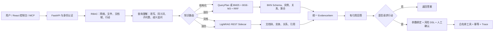

> Archive / 历史文档：保留当时的设计与评测记录；功能现状、启动命令和边界以根目录 [README](../../../README.zh.md) 为准。本机路径已去标识，历史命令不保证适用于当前版本。

# MiniBKN 秋招项目完整说明

## 1. 项目一句话介绍

MiniBKN 是一个面向企业业务知识的 Python AI 应用：它把表格和数据库中的“确定业务事实”、BKN 中定义的对象关系/动作规则，以及企业制度文档中的“非结构化知识”放进同一条可检索、可引用、可执行、可审计的链路。

用户可以直接用自然语言提问。系统会先理解意图，再决定查结构化业务数据、查 LightRAG 文档知识，或并行查询两者；如果用户要求执行业务动作，系统必须再经过权限、风险策略和人工确认，不能由大模型直接调用任意代码。

## 2. 为什么要做这个项目

普通 RAG 擅长从文档中找相似段落，但企业问题经常要求精确计算和关系查询，例如：

- 最近三个月消费最高的五个客户分别由谁负责？
- 哪些订单满足多个条件，总金额是多少？
- 这批客户按制度可以获得多少折扣，谁需要审批？
- 找到高风险客户后，为他们创建跟进任务。

单纯把表格转成文本块再做向量检索，容易漏关系、算错聚合、塞入大量无关上下文，也无法安全执行动作。BKN 的价值是先明确业务对象、字段、关系、动作和风险，再让 AI 在受约束的范围内理解问题和组织结果。

## 3. 项目最初是什么样

项目参考开源 [BKN Foundry](https://github.com/openbkn-ai/bkn-foundry) 的思想，但没有复制完整微服务平台。上游工程规模大、服务和基础设施多，不适合个人在秋招周期内完整复现，因此一开始确定了“Python 主流程优先”的边界。

第一版 MiniBKN 能跑供应链演示：导入 CSV、读取 BKN、生成物料和供应商对象、做 BM25/离线向量检索、回答库存问题，再执行本地补货预警。

它当时存在明显不足：

1. 回答逻辑带有库存字段和供应商关系的业务硬编码；
2. 默认向量是 token hashing，不是真正语义 Embedding；
3. 主外键识别主要依赖字段名，泛化和解释不足；
4. 用户问题直接送去检索，复杂查询没有结构化执行计划；
5. 风险控制和行动链路偏演示化；
6. 新数据需要整批重建，缺少变更集和索引版本；
7. 文档知识只有接口预留，没有真实 LightRAG；
8. 只有统一 API Key，没有用户、角色和文件权限；
9. 200 题早期集合模板化，Ragas 和 Token 数字不足以支撑简历；
10. 文档较多但事实状态容易冲突，其他 AI 难以接手。

## 4. 最终系统架构



核心采用模块化单体和 Ports & Adapters：领域契约不依赖 FastAPI、SQLite、LightRAG 或具体模型；外部能力都通过端口替换。这样保留了系统边界和可测试性，又避免为个人项目引入 Kubernetes、Kafka 等不必要复杂度。

## 5. 从开始到结束做了哪些优化

### 5.1 Python 核心链路

- FastAPI 统一 API 和错误合同；
- SQLite 持久化网络、图、索引清单、建模会话、行动和 Trace；
- CSV、SQLite 数据源接入；
- BKN Lang 子集解析与交叉校验；
- ObjectType、RelationType、ActionType、RiskType 领域模型；
- 对象物化、关系连边、子图遍历和稳定引用。

### 5.2 从供应链专用变成通用企业建模

- 删除回答器中的库存业务判断，改为统一证据回答；
- 增加 CRM、财务、人事等企业数据样例；
- 支持字符串、整数、浮点、布尔、日期、时间、Decimal 和 JSON；
- 主键支持组合键；
- 主外键候选综合字段名、非空率、唯一率、值覆盖率、类型兼容和跨表关系，并返回置信度与原因；
- AI 可补充 Schema 描述，但不能擅自修改字段 ID、主键或映射。

### 5.3 检索和 Embedding

- BM25 负责编号、名称和精确词；
- BGE-M3 负责自然语言和同义表达；
- RRF 融合两种排名；
- Embedding 支持批处理、内存缓存、失败降级；
- 索引保存模型名、维度和版本，模型变化时拒绝使用旧向量；
- 同步模型调用移出事件循环，修复并发请求被串行阻塞的问题。

### 5.4 QueryPlan 和 AI 查询理解

大模型不直接生成 SQL，而是生成受限 JSON 计划。后端只允许：

- 对象选择；
- 白名单字段过滤；
- 关系遍历，最多五跳；
- `count`、`sum`、`avg`、`min`、`max`；
- 排序、投影、分组和限制条数。

执行前会校验对象、字段、关系、行动绑定和扫描上限。查询理解还包括问题改写、关键词、同义词扩展、子问题拆解、低基数字段值校验、相对时间/大客户口径/代词指向的歧义追问。DeepSeek 不可用时回退到确定性规则。

动作意图只会被识别和返回，不能从智能问答接口直接执行。

### 5.5 风险和行动安全

- 行动必须在 BKN 中注册并绑定白名单工具；
- 参数来自已验证的对象属性或允许覆盖项，未知参数拒绝；
- 风险 DSL 只解释白名单表达式，不执行 Python/SQL；
- 策略可根据对象、行动参数和可信身份选择 allow、confirm、deny；
- 高风险行动进入人工确认；
- 幂等键避免重复业务操作；
- 每一步写入 trace_id 事件，可回放请求、风险、审批和工具结果；
- MCP 复用同一行动门禁，不提供绕过通道。

### 5.6 增量更新

新版本不再默认全量重建：

- 对物化对象计算内容哈希；
- 生成 inserted、updated、deleted 变更集；
- 只更新变化的对象、关系和检索文档；
- 只为新增/修改内容重新请求 Embedding；
- 保存索引版本与文档数；
- 失败时不发布不完整结果，旧版本继续可用。

### 5.7 全流程 AI 辅助建模

- 自动发现文件和字段画像；
- 从自然语言创建建模会话；
- 生成逐条 Schema、关系、动作和风险提案；
- 每条提案必须人工接受、修改或拒绝；
- 所有提案处理后才能发布新 BKN；
- AI 失败时仍可用确定性规则创建初始网络。

### 5.8 非结构化文档和 LightRAG

- LightRAG 作为可关闭的独立 REST sidecar；
- 支持中文 Markdown/纯文本提交和异步状态；
- 通过 `/query/data` 获取文档块、图实体关系和引用；
- 统一为 MiniBKN EvidenceItem；
- 自动选择 structured/document，支持 hybrid 并行证据融合；
- sidecar 不可用时按配置降级；
- 公开、销售、财务文档使用独立安全知识域，避免图谱摘要跨权限泄露。

### 5.9 企业权限

- 用户密钥摘要认证；
- 多角色权限合并；
- read/model/execute/approve/audit/admin 功能权限；
- 网络、CSV/SQLite 资源、LightRAG 文档域和行动级授权；
- 检索、QueryPlan 和子图扩展前过滤，不让受限文件进入模型上下文；
- 风险策略使用可信认证身份，阻止客户端伪造角色；
- 默认关闭以兼容纯本地演示，启用后默认拒绝未知用户和非法策略。

### 5.10 UI、MCP 和工程化

- 独立 React 控制台包含数据源、AI 建模、知识网络、问答、行动风险和评测六个工作区；
- MCP stdio 暴露搜索、问答和行动请求；
- Swagger、统一错误码、trace_id、API 输入上限、CORS；
- Ruff、mypy strict、pytest、覆盖率、前端 Vitest/TypeScript/build；
- 一键演示、Docker 配置、评测脚本和原始 JSON 结果；
- 持续维护阶段报告、通俗报告、导航和 AI 交接文档。

## 6. 遇到的主要困难

### 困难一：大模型“会回答”不等于“会正确计算”

复杂聚合题中，向量 RAG 可能只找到少量相似订单，然后根据不完整上下文给出一个听起来合理的数字。解决方式是让 LLM 只做理解，后端 QueryPlan 对全量授权对象执行确定性过滤和聚合。

### 困难二：Faithfulness 高不代表答案正确

传统 RAG 在证据不完整时仍可能非常忠实地复述错误子集，所以 Faithfulness 反而较高。项目因此把检索、事实正确性、回答相关性、上下文精度/召回和噪声敏感度分开评估，并保留原始数据和口径。

### 困难三：聚合证据容易被预算挤掉

早期聚合结果放在证据末尾，只写成字典；上下文预算紧张时会被实例证据挤掉。后来把计算证据移到首位，并改成人类可读、可引用的自然语言。

### 困难四：异步 API 不能被同步模型拖住

Embedding 和纯 Python 排序原先运行在事件循环中，并发请求实际串行。将阻塞工作放入工作线程后，50 并发验收通过，检索质量指标不变。

### 困难五：权限不能只在返回前过滤

如果受限文档已经进入提示词，即使最后删除引用也可能泄露内容。结构化数据必须在召回、图扩展和 QueryPlan 计算前过滤；LightRAG 则按安全知识域隔离工作区。

### 困难六：真实 LightRAG 契约与直觉不同

联调时发现任务查询没有统一顶层状态，而是每份 document 各自带状态；重复文本返回 409；Workspace 名会被规范化。适配器针对这些真实响应增加了状态归纳、重复错误分类和固定 endpoint/workspace 配置。

### 困难七：Windows 中文路径

Python 3.11 editable `.pth` 在部分环境按 GBK 读取 UTF-8 路径会启动失败。项目文档提供 `--no-editable` 安装方案；本轮本地开发也验证了 ASCII 引导路径的处理办法。

## 7. 最终效果和真实数字

以下数字来自不同实验，不能混成一个总分：

- 冻结 CRM 数据：9,140 个对象、9,150 个检索文档、200 道检索题、30 道行动安全题；
- 真实 BGE-M3：BM25 / Vector / Hybrid 的 Hit@1 为 0.700 / 0.515 / 0.700；
- 独立 30 题 DeepSeek + Ragas Faithfulness：平均 0.9261；
- 六项 Ragas 的 10 题分层诊断中，MiniBKN 的 LLM Context Precision 0.9583、Context Recall 1.000、噪声敏感度 0.100；
- 传统混合 RAG Top-20 与冻结 QueryPlan 的同模型 30 题对照：平均输入 Token 844.07 降到 280.40，减少 66.78%；平均总 Token 减少 62.36%；结构化执行 30/30；
- LightRAG 三份真实中文制度文档完成索引，3 个检索问题 3/3；混合问题同时返回 14 条结构化证据和 3 条文档证据；
- 后端上一轮为 71 项通过、89% 行覆盖率；本轮新增 RBAC/LightRAG 测试后的准确总数以最新最终验收记录为准；
- 前端上一轮 8 项测试、TypeScript 和生产构建通过。

这些结果证明的是：在当前冻结 CRM 多跳/聚合集合上，结构化执行能显著缩小上下文并提高证据覆盖；不应外推成“所有行业所有问题都降低 66.78%”。

## 8. 系统能给用户带来什么便利

### 对业务人员

- 不必会 SQL，只用自然语言；
- 问得不清楚时系统主动追问，而不是猜答案；
- 一个入口同时查询业务表和企业制度；
- 每个结论都能点回 BKN 定义、数据行或文档块；
- 可以从“查到问题”继续发起业务动作，不需要切换多个系统。

### 对管理者

- 业务规则、审批条件和风险策略可以显式管理；
- 不同岗位看到不同文件和文档域；
- 高风险动作必须确认；
- 失败、拒绝、审批和执行结果都可审计。

### 对开发团队

- 新业务主要增加数据和 BKN 定义，不改核心检索代码；
- LLM、Embedding、LightRAG、数据库和工具都通过适配器替换；
- 离线 fallback 让测试不依赖云服务；
- 增量构建减少重算和 API 成本；
- 原始评测结果可复算，避免“凭感觉优化”。

## 9. 为什么它是有用的 AI 应用

这个项目没有把 AI 当数据库或执行器，而是把 AI 放在最适合的位置：理解含糊语言、生成受限计划、补充建模描述和整理证据。精确计算、权限判断、风险策略和工具执行仍由确定性程序负责。

因此它同时具备 AI 的便利与企业系统需要的约束：

```text
自然语言易用性
+ 结构化计算准确性
+ 文档知识覆盖
+ 权限隔离
+ 行动安全
+ 引用和审计
```

与普通“上传 PDF 然后聊天”的 Demo 相比，它能回答跨表、多跳、聚合问题，并把回答安全地连接到业务动作；与传统固定报表相比，它又允许用户直接用自然语言探索没有预先写好的问题。

## 10. 如何演示

推荐演示 CRM：

1. 导入 CRM BKN 和 CSV，展示自动字段画像及主外键候选；
2. 构建对象图和 BGE-M3 混合索引；
3. 问一个含“最近”或“大客户”的模糊问题，展示自动追问；
4. 回答跨客户、订单和销售负责人的 QueryPlan 问题；
5. 问“折扣审批制度”，展示 LightRAG 文档引用；
6. 问“客户订单与折扣制度”，展示混合证据；
7. 分别使用销售和财务身份，展示文件/文档域差异；
8. 发起跟进或预警行动，展示风险模拟、人工确认和 Trace。

启动、API 顺序和评测命令见根目录 `README.md`、`docs/ACCEPTANCE.md` 和两份 0.6.0 专项开发报告。

## 11. 诚信边界

- 这是参考开源 BKN Foundry 思想完成的个人 Python 复现与增强项目，不是上游完整平台；
- 当前数据为合成 CRM/企业场景，不是真实公司生产数据；
- RBAC 是本地策略文件方案，不等于完整 IAM/SSO；
- LightRAG 真实运行了一个 public 工作区，多安全域并行通过自动化适配器测试；
- 评测数字必须附带样本量、模型、问题类型和基线；
- “NUS 研究项目”等身份只能在确有可核验证据时使用。

## 12. 关键阅读入口

- 项目导航：`docs/MINIBKN_DOCUMENTATION_NAVIGATION.md`
- 系统架构：`docs/ARCHITECTURE.md`
- 全量测试：`docs/reports/MINIBKN_COMPREHENSIVE_TEST_ACCEPTANCE_REPORT.md`
- 查询智能与 Ragas/Token：`docs/reports/MINIBKN_QUERY_INTELLIGENCE_AND_FULL_EVALUATION_REPORT.md`
- 权限：`docs/reports/MINIBKN_ENTERPRISE_ACCESS_CONTROL_DEVELOPMENT_REPORT.md`
- LightRAG：`docs/reports/MINIBKN_LIGHTRAG_INTEGRATION_AND_EVALUATION_REPORT.md`
- 原始结果：`evals/results/`
